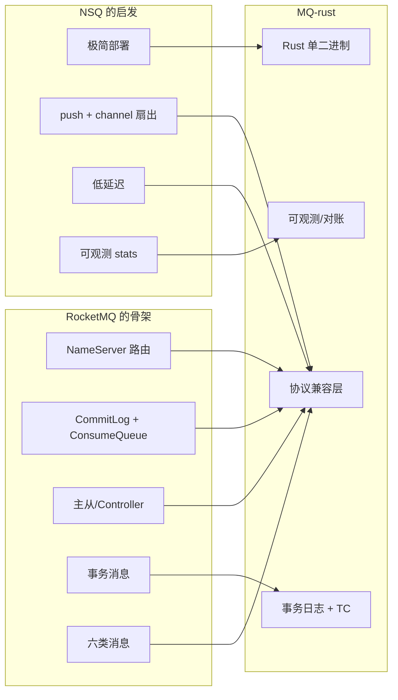

# 00 · 项目总览与关键决策

> 版本：R0（2026-11-24）  
> 状态：设计基线，待 R1 代码验证  
> 关联：`README.md`、`02-RocketMQ架构分析.md`、`05-事务性设计.md`、`09-路线图与迭代计划.md`

---

## 1. 问题陈述

电商与金融交易的消息中间件通常同时面对三类矛盾：

1. **吞吐 vs 可靠**：大促峰值需要十万级 TPS，但订单、支付、账务消息不能丢。
2. **异步 vs 一致**：业务希望用消息解耦，但“订单落库”和“消息发出”必须要么都成功、要么都不成功。
3. **低延迟 vs 可回放**：交易链路要求毫秒级，风控/对账又要求可追溯、可重放、可补偿。

RocketMQ 用 CommitLog、ConsumeQueue、NameServer、Half Message 给出了工业级答案；NSQ 用极简的 topic/channel 和 push 模型给出了低延迟、易运维的答案。MQ-rust 的目标是把两者“可验证的优点”合并：

- **RocketMQ 的协议、存储骨架、功能完整度**；
- **NSQ 的部署简单性、低延迟 push、可观测性**；
- **比 RocketMQ 更明确、更可审计的事务语义**；
- **Rust 的确定性延迟、内存安全与零拷贝能力**。

---

## 2. 目标（可验收）

### 2.1 功能目标

| 编号 | 目标 | 验收方式 |
|---|---|---|
| F1 | RocketMQ 4.9.x Remoting 协议兼容 | 4.9.8 Java SDK 完成 topic 创建、同步/异步/单向发送、push/pull 消费 |
| F2 | RocketMQ 5.x gRPC/Proxy 兼容 | 5.3+ Java SDK 通过 Proxy 完成收发 |
| F3 | 六类消息 | 普通、顺序、事务、定时/延时、批量、死信，逐项集成测试 |
| F4 | 事务消息 | 本地事务提交/回滚、宕机回查、超时回滚、重复提交幂等 |
| F5 | 消费语义 | 集群/广播、至少一次、重试、DLQ、位点提交、幂等消费 |
| F6 | 可观测 | 收发/存储/事务/复制/消费积压指标 + Dashboard + 告警 |
| F7 | 运维 | topic/group/offset/ACL 管理、滚动升级、扩缩容、备份恢复 |

### 2.2 非功能目标

| 指标 | 目标（首版） | 说明 |
|---|---|---|
| 单机吞吐 | 1 KiB，3 副本，同步刷盘 ≥ 5 万 TPS；异步刷盘 ≥ 20 万 TPS | 与同机 Java RocketMQ 5.5 对比，≥1.2× 为优 |
| 端到端延迟 | 同机 P99 < 20 ms；P999 < 50 ms | 同步发送、单条、无积压 |
| 事务开销 | 事务消息 TPS ≥ 普通消息的 70% | 同负载、同副本 |
| 可靠性 | 单 Broker 进程崩溃 0 丢失（同步复制）；单盘故障可恢复 | 故障注入 |
| 可用性 | 3 节点集群，单节点故障 RTO < 30 s，RPO = 0（同步复制） | Controller 选举 + fencing |
| 容量 | 单集群 10 万+ Topic、百万级 Consumer Group（规划值） | 元数据分片 |
| 可观测 | 关键路径 100% 有 metrics/trace；事务异常 100% 有审计 | 验收清单 |

> 性能数字是“工程目标”，不是营销承诺。每轮必须记录硬件、内核、JVM、参数、消息大小、副本数、客户端并发，否则数据无效。

---

## 3. 范围

### 3.1 首版包含

- NameServer 集群、Broker 主从、Proxy、Controller（openraft）。
- CommitLog/ConsumeQueue/IndexFile/WAL 的 Rust 实现。
- RocketMQ 4.9 Remoting 与 5.x gRPC 的核心命令子集。
- 六类消息、重试、DLQ、Tag/SQL92 过滤、消息轨迹。
- 事务消息：Half、Op、Check-back、TC、幂等、对账。
- 可观测、ACL、管理 API/CLI。
- Java SDK 兼容测试、性能压测、混沌测试、容器化部署。

### 3.2 首版不包含

- Kafka 协议、AMQP、MQTT（后续 MQTT 可作为独立模块）。
- 跨地域强一致、全球顺序。
- 与 RocketMQ DLedger 磁盘格式互通。
- 完整 Web Console（首版提供 API + 简易页面）。
- 流计算引擎（Flink/Spark 连接器后续）。

---

## 4. 关键设计决策（ADR 摘要）

| ID | 决策 | 理由 | 代价/风险 |
|---|---|---|---|
| ADR-001 | **协议优先兼容 RocketMQ 4.9 Remoting** | Java SDK 生态最大，改造成本最低 | 需精确复刻 JSON header、extFields、错误码 |
| ADR-002 | **5.x 通过 gRPC Proxy 兼容** | 避免在 Broker 内同时维护两套协议 | Proxy 增加一跳，需做零拷贝/连接复用 |
| ADR-003 | **存储自研 CommitLog，不直接用 RocksDB 存消息** | 顺序写 + 零拷贝 + 可预测延迟；RocksDB 写放大不适合海量消息 | 需自己实现恢复、索引、保留策略 |
| ADR-004 | **元数据/Controller/TC 用 openraft** | 强一致、成熟、活跃；避免自研 Raft | Raft 只承载元数据/事务状态，不承载消息体 |
| ADR-005 | **消息复制用主从 + ISR，不用每条消息过 Raft** | 吞吐优先；Raft 每消息写放大不可接受 | 需处理脑裂、fencing、截断 |
| ADR-006 | **事务日志独立于 Half Topic 扫描** | 状态可审计、回查可分片、恢复快 | 需保证事务日志与消息物化的原子性 |
| ADR-007 | **消费语义默认至少一次，exactly-once 作为可选能力** | 跨系统 exactly-once 不现实；诚实边界 | 需提供幂等 SDK、Inbox、对账工具 |
| ADR-008 | **Tokio 为首发运行时，io_uring 可选** | 跨平台、生态成熟；Windows 开发环境必须可用 | Linux 极致性能需额外 feature |
| ADR-009 | **不 fork rocketmq-rust，但将其作为参考实现与兼容性对打对象** | 保持架构自主；复用其协议测试思路 | 需要自己踩坑，前期慢 |
| ADR-010 | **Windows 保功能、Linux 保性能** | 当前开发机是 Windows；生产目标是 Linux | 零拷贝/fflush 语义需平台抽象 |

> 关于 ADR-009：`mxsm/rocketmq-rust` 已实现较完整的 Remoting/Store/ Broker，且 Apache-2.0。我们**不直接复制其代码**，但会：
> 1. 用它的协议兼容性测试用例做交叉验证；
> 2. 在性能对比中把它作为 Rust 基线之一；
> 3. 对其事务实现做差异化：独立 TC、Raft 事务日志、消费幂等与对账。

---

## 5. 与 NSQ / RocketMQ 的关系

**借鉴 NSQ**：部署拓扑简单、push 消费、channel 式扇出、stats 友好、消息不强制持久化（可配置）。
**不照搬 NSQ**：无副本、无顺序、无事务、无全局位点、无延迟调度。

**借鉴 RocketMQ**：NameServer、CommitLog/ConsumeQueue、主从、事务半消息、六类消息、Java SDK 生态。
**改进 RocketMQ**：事务日志与 TC 独立、回查可分片、消费幂等内建、Rust 内存/IO 控制、云原生部署。

---

## 6. 成功标准（Definition of Done）

### 6.1 R1（单机可用）

- [ ] `cargo build --release` 在 Windows/Linux 通过。
- [ ] NameServer + Broker 启动，RocketMQ 4.9.8 Java SDK 能创建 topic、发送/消费普通消息。
- [ ] 消息重启后可恢复，ConsumeQueue 可重建。
- [ ] 兼容性测试脚本与报告入库。

### 6.2 R3（事务可用）

- [ ] `TransactionMQProducer` 发送半消息，本地事务提交后消费者可见。
- [ ] 本地事务回滚后消费者不可见。
- [ ] 杀 Producer 后 Broker 回查同组其他实例，最终 commit/rollback。
- [ ] 重复 commit/rollback 幂等；超时事务按策略回滚并审计。
- [ ] 事务消息 TPS ≥ 普通消息 70%。

### 6.3 R5（1.0 验收）

- [ ] 六类消息全通过；RocketMQ 4.9/5.x SDK 兼容矩阵全绿。
- [ ] 3 节点集群单节点故障 RTO < 30s、RPO=0（同步复制）。
- [ ] 性能达到第 2.2 节目标，报告可复现。
- [ ] 混沌测试 20+ 场景通过；监控 Dashboard/告警可用。
- [ ] 文档、部署、升级、回滚、对账手册齐全。

---

## 7. 主要风险

| 风险 | 概率 | 影响 | 缓解 |
|---|---|---|---|
| RocketMQ 协议细节复刻偏差 | 高 | Java SDK 不可用 | 以 4.9.8 源码/抓包为准，建立 golden 测试 |
| 事务日志与消息物化不一致 | 中 | 消息重复/丢失 | 两阶段状态机 + 幂等物化 + 对账修复 |
| 主从脑裂 | 中 | 双写/数据分叉 | Controller epoch + fencing + 少数派拒写 |
| Windows 开发环境与 Linux 生产差异 | 高 | 性能/语义偏差 | 平台抽象层；CI 双平台；性能只在 Linux 认定 |
| 回查风暴 | 中 | Broker CPU/网络抖动 | 分片扫描、退避、限流、批量回查 |
| 范围过大 | 高 | 延期 | 按 R1-R5 Gate 切分；每轮只承诺可验收子集 |
| 缺少 Docker/WSL | 中 | 容器化测试受阻 | 原生进程 harness 先跑通；交付 compose 文件，Linux 环境补跑 |

---

## 8. 阅读顺序

1. 想了解“为什么” → 本文件 + `01/02` 架构分析。
2. 想了解“做什么” → `03-功能图谱` + `10-测试与验收`。
3. 想了解“事务怎么做” → `05-事务性设计`。
4. 想了解“怎么实现” → `06/07/08`。
5. 想了解“怎么推进” → `09-路线图` + `13-第一轮执行记录`。
