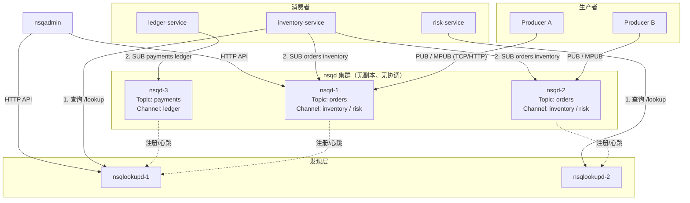
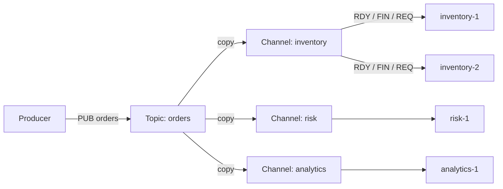

# 01 · NSQ 架构分析：极简的代价与可借鉴之处

> 依据：NSQ 官方文档 v1.3.0（[Design](https://nsq.io/overview/design.html)、[Internals](https://nsq.io/overview/internals.html)、[Features & Guarantees](https://nsq.io/overview/features_and_guarantees.html)、[TCP Protocol](https://nsq.io/clients/tcp_protocol_spec.html)）与 `nsqio/nsq` 源码结构。  
> 结论先行：NSQ 是“低延迟、易运维、无副本、无顺序、无事务”的实时消息平台；MQ-rust 借鉴其部署与消费模型，但**不继承其可靠性边界**。

---

## 1. 组件与拓扑

NSQ 由三个守护进程组成（[Internals](https://nsq.io/overview/internals.html)）：

| 组件 | 职责 |
|---|---|
| `nsqd` | 接收、排队、投递消息；一个进程可承载多个 topic/channel；内存队列 + DiskQueue |
| `nsqlookupd` | 拓扑发现服务；nsqd 主动上报，consumer 通过 HTTP `/lookup` 查询；节点间不协调，最终一致 |
| `nsqadmin` | Web UI；查看 topic/channel/consumer、depth、执行清空/删除等管理操作 |



**关键点**：nsqd 之间不通信、不复制；producer 通常只连一个 nsqd（或按分片连多个）；consumer 连接**所有**提供目标 topic 的 nsqd，才能消费全量。拓扑上没有“中间 Broker”，因此也没有天然的 SPOF，但**每个 nsqd 自己就是数据的唯一副本**。

---

## 2. 核心模型：Topic → Channel → Consumer

NSQ 的数据流是一棵树（[Design](https://nsq.io/overview/design.html)）：

- **Topic**：一条逻辑消息流，首次 publish 或 subscribe 时自动创建。
- **Channel**：topic 的独立副本；每个 channel 收到 topic 的**全量拷贝**，实现多播。
- **Consumer**：同一 channel 上的多个客户端**竞争**消费，实现负载均衡。



**多播 + 负载均衡**是 NSQ 最优雅的设计：新增一个下游服务，只需新增 channel 并启动 consumer，无需改 producer、无需迁移数据。代价是每个 channel 都独立缓冲，磁盘放大 = channel 数 × 消息量。

### 2.1 消息生命周期

1. Producer 发送 `PUB`/`MPUB`/`DPUB`。
2. nsqd 将消息写入 topic 的内存队列；超过 `--mem-queue-size` 后溢出到 DiskQueue。
3. topic 的 `messagePump` 把消息复制到每个 channel。
4. channel 在有 consumer `RDY` 时推送消息，并放入 in-flight 队列。
5. Consumer 处理成功后 `FIN`；失败/超时 `REQ` 或超时重投。
6. 消息在 channel 维度被确认后删除；topic 本身不保留“消费位点”。

> 注意：NSQ 的“持久化”是**队列溢出到磁盘**，不是 RocketMQ 那样的统一 CommitLog；消息被所有 channel 消费后即可删除，没有长期回放能力。

---

## 3. 存储：内存优先 + DiskQueue

NSQ 的设计目标之一是**限制单进程内存**（[Design · Bounded Memory Footprint](https://nsq.io/overview/design.html)）：

- 每个 topic/channel 有一个 buffered Go channel，容量 = `--mem-queue-size`。
- 队列满后，消息透明写入 `DiskQueue`；DiskQueue 是长度前缀的文件队列，支持 unclean restart 恢复（可能重复）。
- `#ephemeral` 后缀的 topic/channel 不落盘，超过内存阈值直接丢弃，最后一个客户端断开后消失。
- 干净 shutdown（TERM）会持久化内存、in-flight、deferred 消息；**非干净宕机**会丢失内存与未 flush 的写。

**对 MQ-rust 的启示**：
- “内存优先、磁盘兜底”适合低延迟实时流，但不适合订单/支付。MQ-rust 默认应“先写 CommitLog，再投递”，用异步刷盘换吞吐，而不是先内存后落盘。
- DiskQueue 的“每 channel 独立队列”会导致磁盘放大；RocketMQ 的 ConsumeQueue 只存索引（20B/条），消息体共享 CommitLog，更适合多下游。

**源码核对默认值**（`nsqd/options.go`，NSQ 1.3.0）：

| 参数 | 默认值 |
|---|---|
| `--mem-queue-size` | 10000 |
| `--msg-timeout` | 60s |
| `--max-msg-timeout` | 15m |
| `--max-rdy-count` | 2500 |
| `--max-defer-timeout`（HTTP/DPUB） | 1h（文档口径，源码按版本核对） |

---

## 4. 协议与投递语义

### 4.1 TCP 协议

NSQ 协议是长度前缀的帧（[TCP Protocol Spec](https://nsq.io/clients/tcp_protocol_spec.html)）：

```text
[x][x][x][x][x][x][x][x][x][x][x][x]...
|  (int32)  ||  (int32)  || (binary)
|  4-byte   ||  4-byte   || N-byte
------------------------------------...
    size       frame type    data
```

> `frame type`：0 = response，1 = error，2 = message（见 NSQ TCP 协议规范）。

核心命令：
- 生产：`PUB`、`MPUB`、`DPUB`（deferred publish）。
- 消费：`SUB`、`RDY`、`FIN`、`REQ`、`TOUCH`。
- 连接：`IDENTIFY`、`AUTH`、`NOP`、`CLS`。
- 心跳：nsqd 周期性发送 `_heartbeat_`，客户端必须响应；所有网络 IO 带 deadline。

`RDY` 是客户端侧流控：客户端声明“还能处理多少条”，nsqd 按此推送，避免把消费者打爆。这是 NSQ 低延迟与背压的核心。

### 4.2 投递保证

官方明确（[Features & Guarantees](https://nsq.io/overview/features_and_guarantees.html)）：

| 保证 | NSQ 的答案 |
|---|---|
| 持久性 | 默认**不持久**；`mem-queue-size=0` 可全量落盘，但仍有单机故障风险 |
| 副本 | **没有内置复制**；靠部署冗余 nsqd 对、消费者幂等来兜底 |
| 投递 | **at-least-once**；超时、断连、REQ 都会重复 |
| 顺序 | **不保证**；requeue、内存/磁盘混合、多 nsqd 都破坏顺序 |
| 发现 | 最终一致；lookupd 节点不协调，消费者合并所有响应 |

**这意味着 NSQ 不能直接用于订单、支付、账务**：它把“可靠性”下推给了部署拓扑和业务幂等。

---

## 5. 性能设计

NSQ 的性能来自“少做事”：

- **push 模型 + RDY 流控**：减少 pull 轮询与空转。
- **长度前缀协议 + 预分配/复用 buffer**：减少解析分配（[Internals](https://nsq.io/overview/internals.html)）。
- **每 channel 独立 goroutine / 定时器**：避免全局锁与全局定时器。
- **内存队列 + 批量磁盘写**：常态低延迟，峰值才落盘。
- **HTTP `/stats` + statsd**：轻量可观测。

但它没有解决：
- 多副本同步的写放大与延迟；
- 海量 topic 的元数据管理；
- 长期存储与按时间回放；
- 事务与顺序。

---

## 6. 运维与可观测

NSQ 的运维体验值得学习：

- `nsqadmin` 直接展示 topic/channel/consumer 层级、depth、in-flight、deferred、requeue、timeout。
- `statsd` 指标 + `pprof` 运行时分析。
- 配置少、默认值合理、单二进制部署。
- 拓扑模式清晰（[Topology Patterns](https://nsq.io/deployment/topology_patterns.html)）：单 nsqd、nsqd 对、多 nsqd + lookupd。

MQ-rust 应保留：
- 单二进制、少配置、开箱即用的本地模式；
- topic/group/queue 层级化 Dashboard；
- `stats` 风格的文本/JSON 诊断端点；
- 明确的“当前拓扑与副本状态”视图。

---

## 7. NSQ 的优点与硬伤

| 维度 | 优点 | 硬伤 | MQ-rust 的取舍 |
|---|---|---|---|
| 部署 | 无 Broker、无协调、单二进制 | 每个 nsqd 是数据孤岛 | 保留单二进制；增加 NameServer + 主从 |
| 延迟 | push + RDY，极低 | 无副本，宕机即丢 | 保留 push/long-poll；先落盘再投递 |
| 扩展 | 加 nsqd 即可扩容 | 无自动 rebalance、无全局位点 | NameServer 路由 + 队列级扩缩容 |
| 多播 | channel 天然扇出 | 每 channel 独立存储，磁盘放大 | Consumer Group + ConsumeQueue 索引共享 |
| 可靠 | at-least-once、客户端可控 | 无复制、无顺序、无事务 | 主从/ISR + 顺序队列 + 事务消息 |
| 运维 | stats/admin 简单直观 | 缺少事务/复制/积压治理 | 保留简洁 UI，增加事务/复制面板 |

---

## 8. 对 MQ-rust 的 8 条具体启示

1. **保留“Topic → Consumer Group → Queue”三层语义**，但用 RocketMQ 的 ConsumeQueue 共享消息体，避免 NSQ 的 channel 存储放大。
2. **保留 push 消费与长轮询**：Push 本质是 Broker 侧 long-poll + 客户端流控；不要做成纯 pull 轮询。
3. **RDY 的流控思想**：在 gRPC/Remoting 层实现 per-consumer in-flight 限额与背压。
4. **默认先写 WAL 再 ACK**：不以“内存队列”作为默认可靠路径；内存只做写缓存。
5. **别把“无副本”当高可用**：NSQ 的“无 SPOF”是拓扑意义上的，不是数据意义上的；MQ-rust 必须有副本与选主。
6. **延迟/定时消息不能只靠客户端 requeue**：NSQ 的 `DPUB` 是服务端延迟，但没有任意时刻调度与持久化保证；MQ-rust 用时间轮 + 延时日志。
7. **运维界面按“层级 + 深度 + 速率 + 错误”组织**：这是 NSQ 最值得抄的 UX。
8. **不要承诺顺序**：NSQ 明确“无序”；MQ-rust 只对“同一队列 + 顺序消费”承诺顺序，并在文档中写清边界。

---

## 9. 参考源码入口

| 主题 | 路径 |
|---|---|
| 协议帧/命令 | `nsqio/nsq/internal/protocol/` |
| topic/channel | `nsqio/nsq/nsqd/topic.go`、`channel.go` |
| DiskQueue | `nsqio/nsq/nsqd/diskqueue.go` |
| 服务端 | `nsqio/nsq/nsqd/nsqd.go`、`tcp.go`、`http.go` |
| 发现 | `nsqio/nsq/nsqlookupd/` |
| 客户端示例 | `nsqio/go-nsq/` |

> 说明：以上路径基于 NSQ 1.x 仓库结构；R1 会拉取指定 tag 做源码级核对，并把关键结论回写到本文件。
