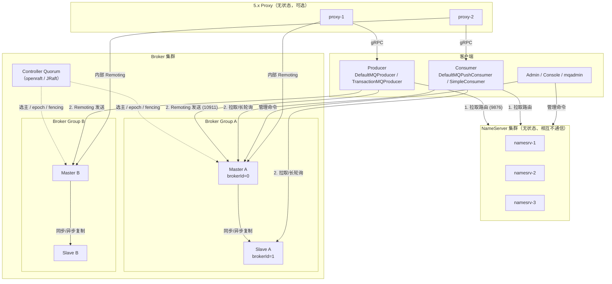
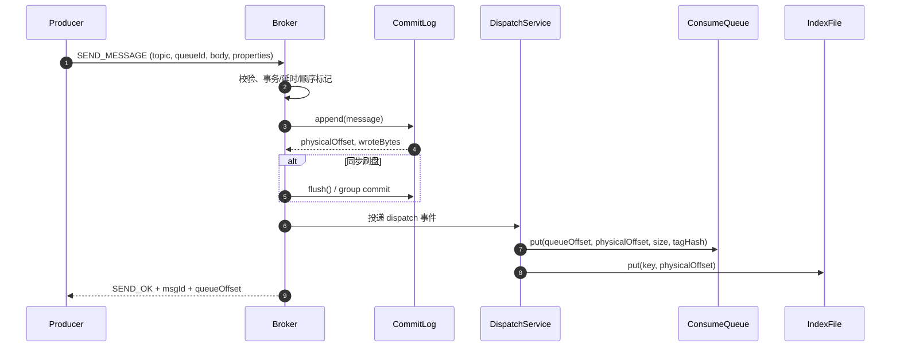
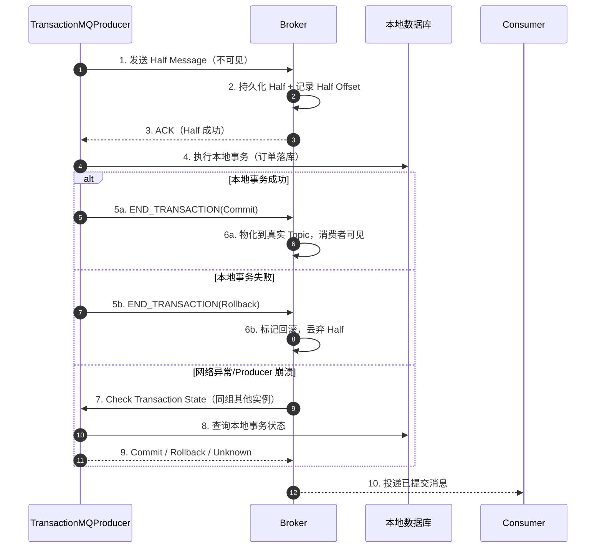

# 02 · RocketMQ 架构分析：1:1 对标基线

> 依据：Apache RocketMQ 官方文档 4.x/5.x（[Domain Model](https://rocketmq.apache.org/docs/domainModel/01main)、[5.0 速览](https://rocketmq.apache.org/zh/version/)、[Deployment](https://rocketmq.apache.org/docs/deploymentOperations/01deploy/)、[Transaction Message](https://rocketmq.apache.org/docs/featureBehavior/04transactionmessage/)、[Storage](https://rocketmq.apache.org/docs/featureBehavior/11messagestorepolicy/)、[4.x 服务端配置](https://rocketmq.apache.org/zh/docs/4.x/parameterConfiguration/02server/)）与 `apache/rocketmq` 源码。  
> 结论先行：RocketMQ 的核心不是“某个队列”，而是 **CommitLog + ConsumeQueue 的读写分离、NameServer 的最终一致路由、主从/Controller 的复制、Half Message 的两阶段事务**。MQ-rust 的 1:1 对标以 4.9.x Remoting 为主，5.x gRPC 通过 Proxy 补齐。

---

## 1. 逻辑架构



### 1.1 组件职责

| 组件 | 职责 | 关键设计 |
|---|---|---|
| **NameServer** | 路由注册与发现；Broker 心跳；Topic 路由查询 | 无状态、节点间不通信、最终一致；部署 3 节点即可 |
| **Broker** | 消息存储、复制、消费位点、重试、事务、过滤 | CommitLog 顺序写；ConsumeQueue 逻辑队列；主从复制 |
| **Producer** | 发送、重试、故障节点隔离、事务半消息 | 轻量、匿名；4.x 富客户端负责路由/重试 |
| **Consumer** | 拉取/推送、负载均衡、位点、重试 | 集群/广播；Push 本质是长轮询 + 客户端消费 |
| **Proxy（5.x）** | 协议适配、鉴权、消费管理、gRPC | 无状态，可独立弹性伸缩；Local 模式与 Broker 同进程 |
| **Controller（5.x）** | 自动主从切换、选主、epoch | 可独立部署或内嵌 NameServer；替代人工切换 |

> 4.x 的 Broker 同时承担“存储 + 协议 + 消费管理”；5.x 将计算逻辑拆到 Proxy，Broker 更专注存储。MQ-rust 首版同时支持 Local 模式（单进程）与 Cluster 模式（Proxy 独立）。

---

## 2. 存储：CommitLog + ConsumeQueue + IndexFile

### 2.1 文件组织

```text
${storePathRootDir}/
├── commitlog/
│   └── 00000000000000000000   # 1GB 顺序追加，所有 Topic 共享
├── consumequeue/
│   └── ${topic}/
│       └── ${queueId}/
│           └── 00000000000000000000  # 每条 20B：offset + size + tagHash
├── index/
│   └── 20261124120000000      # 按 key 的哈希索引
├── config/
│   ├── topics.json
│   ├── consumerOffset.json
│   └── subscriptionGroup.json
└── checkpoint                 # 刷盘/主从位点
```

| 文件 | 作用 | 写入 | 读取 |
|---|---|---|---|
| **CommitLog** | 消息体 + 属性 + 元数据的唯一真相 | 顺序 append；单写锁/批量刷盘 | 按物理 offset 随机读；PageCache 命中则内存读 |
| **ConsumeQueue** | 逻辑队列索引，消费者按 queue offset 拉取 | Dispatch 线程异步构建 | 顺序读 20B 条目，再回查 CommitLog |
| **IndexFile** | 按 key/timestamp 查询消息 | 异步构建 | 哈希定位 + 链表 |
| **Checkpoint** | 刷盘位点、主从位点、异常恢复 | 周期写 | 启动恢复 |

**关键点**：CommitLog 是“物理日志”，ConsumeQueue 是“逻辑索引”。消息只存一份，多个 Consumer Group 共享消息体，避免 NSQ channel 式的存储放大。

### 2.2 写入路径



- **刷盘**：`ASYNC_FLUSH`（默认，PageCache 后返回）与 `SYNC_FLUSH`（组提交后返回）。
- **复制**：`ASYNC_MASTER` / `SYNC_MASTER`；同步双写官方文档称性能约低 10%。
- **Dispatch**：CommitLog 追加后异步构建 ConsumeQueue；构建落后会影响“可消费位点”，但不影响写入。
- **恢复**：启动扫描 CommitLog，重建 ConsumeQueue/Index，修复 checkpoint。

### 2.3 读取路径

1. Consumer 请求 `PULL_MESSAGE(topic, queueId, queueOffset, maxMsgNums)`。
2. Broker 读 ConsumeQueue 条目，得到 physicalOffset/size。
3. 按 physicalOffset 从 CommitLog 读消息体；命中 PageCache 则零磁盘 IO。
4. 应用 Tag/SQL92 过滤。
5. 返回消息列表；无消息则长轮询挂起（Push 消费）。

**性能关键**：顺序写 CommitLog、索引与消息体分离、PageCache 预热、长轮询减少空拉、批量拉取/发送。

---

## 3. 高可用与复制

| 模式 | 机制 | 优点 | 缺点 |
|---|---|---|---|
| **多 Master 无 Slave** | 每个 Broker 都是 Master | 配置简单、性能最高 | 单机宕机期间该节点消息不可消费；磁盘故障可能丢 |
| **Master-Slave 异步复制** | Slave 拉取 CommitLog | 性能几乎不降；Master 宕机可从 Slave 消费 | Master 宕机可能丢少量消息 |
| **Master-Slave 同步双写** | Master 等 Slave 写成功再返回 | 不丢消息；服务/数据无单点 | 性能约低 10%；4.x 需人工切换 |
| **DLedger / Controller** | Raft 选主 + 自动切换 | 自动故障转移、RPO=0（同步） | 复杂度高；Controller 与 NameServer 部署耦合 |

5.x 的 Controller 模式将“选主”从 Broker 中剥离：Controller 维护 Broker 组状态，Master 失效后提升 Slave，并通过 epoch/fencing 阻止旧 Master 继续写入。MQ-rust 采用 **openraft 做 Controller/TC**，消息复制仍走主从 + ISR，避免每条消息过 Raft。

---

## 4. 消息类型与能力

| 类型 | 实现要点 | 关键限制 |
|---|---|---|
| **普通消息** | 任意 queue 写入；消费者按 queue 拉取 | 无顺序保证 |
| **顺序消息** | Producer 按 sharding key 选同一 queue；Consumer 顺序消费（加锁/单线程） | 只保证同 queue 内顺序；失败会阻塞后续 |
| **事务消息** | Half Message + Op Queue + Check-back | 只保证“本地事务 ↔ 发送”最终一致；消费需幂等；见 `05` |
| **定时/延时** | 4.x 18 个延迟级别；5.x 定时轮/任意时间 | 4.x 不支持任意延时；5.x 精度与容量受限 |
| **批量消息** | 批量编码为一条 CommitLog 记录 | 总大小限制（默认 4MB）；批量内不保证逐条重试 |
| **死信** | 超过最大重试次数进入 `%DLQ%{group}` | 需人工/工具处理；不自动重投 |

其他能力：
- **Tag 过滤**：ConsumeQueue 存 tag hash，Broker 侧先过滤。
- **SQL92 过滤**：`enablePropertyFilter=true`，基于属性做表达式过滤。
- **消息轨迹**：TraceTopic，记录生产/存储/消费轨迹。
- **ACL**：AK/SK、Topic/Group 权限、IP 白名单。
- **消费模式**：集群（queue 分配给组内消费者）、广播（每个消费者全量）。
- **消费位点**：集群模式存 Broker（`consumerOffset.json`），广播模式存客户端。

---

## 5. 事务消息（摘要）

RocketMQ 的两阶段事务消息：



关键实现（4.9.x）：
- Half Topic：`RMQ_SYS_TRANS_HALF_TOPIC`。
- Op Topic：`RMQ_SYS_TRANS_OP_HALF_TOPIC`，记录已 commit/rollback 的 half offset。
- 回查：`TransactionalMessageCheckService` 周期扫描 half topic，减去 op 队列，找出未决 half；通过 `CHECK_TRANSACTION_STATE` 请求 Producer Group。
- 默认参数（4.9.x BrokerConfig，待 R1 源码复核）：`transactionCheckMax=15`、`transactionCheckInterval=60s`、`transactionTimeOut=6s`；超过最大回查次数丢弃并记录错误。
- 核心类：`TransactionalMessageService`、`TransactionalMessageBridge`、`TransactionalMessageCheckService`、`EndTransactionProcessor`、`TransactionMQProducer`。

**语义边界（官方明确）**：只保证“本地核心事务与下游分支”的最终一致；**不保证消费结果与上游执行结果一致**，消费失败要靠重试，消费幂等由业务负责（[Transaction Message · Usage limits](https://rocketmq.apache.org/docs/featureBehavior/04transactionmessage/)）。

---

## 6. 性能：官方口径与工程事实

- 官方将 RocketMQ 定位为“万亿级吞吐”的金融级消息平台（集群级容量目标），但**没有给出统一的单机 benchmark 数字**；不同版本、硬件、消息大小、副本/刷盘策略差异极大。
- 官方部署文档明确：同步双写比异步复制**性能约低 10%**，单条 RT 略高（[Deployment](https://rocketmq.apache.org/docs/deploymentOperations/01deploy/)）。
- 工程上影响性能的关键：
  1. CommitLog 单写锁 + 刷盘策略；
  2. PageCache 命中率与冷读；
  3. Dispatch 构建 ConsumeQueue 的速度；
  4. 主从复制 RTT 与批量；
  5. 客户端批量/并发/长轮询；
  6. JVM GC 与堆外内存。

> MQ-rust 不引用“某博客的 7 万/12 万 TPS”作为目标；以**同机、同负载、同副本**的 Java RocketMQ 5.5 实测为基线，在 `11-性能基准` 中记录完整条件。

---

## 7. 协议与 SDK

### 7.1 4.x Remoting

- 端口：NameServer `9876`，Broker `10911`（VIP `10909`）。
- 帧格式：`totalLen(4) + headerLen(4) + header(JSON) + body`；`totalLen` **不包含自己的 4 字节**（`totalLen = 4 + headerLen + bodyLen`，与 4.9.x `RemotingCommand.encodeHeader()` 一致）。
- Header 字段：`code`、`language`、`version`、`opaque`、`flag`、`remark`、`extFields`。
- 请求码：`SEND_MESSAGE=10`、`PULL_MESSAGE=11`、`QUERY_CONSUMER_OFFSET=14`、`UPDATE_CONSUMER_OFFSET=15`、`GET_ROUTEINFO_BY_TOPIC=105`、`HEART_BEAT=34`、`END_TRANSACTION=37`、`CHECK_TRANSACTION_STATE=39` 等。
- Java SDK：`DefaultMQProducer`、`DefaultMQPushConsumer`、`TransactionMQProducer`、`MessageListenerConcurrently/Orderly`。

### 7.2 5.x gRPC / Proxy

- 新 SDK 基于 gRPC，API 更轻；`SimpleConsumer` 支持单条 ack/retry/changeInvisibleDuration。
- Proxy 无状态，支持 Local/Cluster 两种部署；客户端通过 Proxy 访问 Broker。
- 5.x 保持对 4.x SDK 的兼容（官方 5.0 升级说明）。

### 7.3 MQ-rust 兼容策略

| 客户端 | 接入方式 | 首版优先级 |
|---|---|---|
| Java 4.9.x `DefaultMQProducer/Consumer` | Remoting 9876/10911 | P0 |
| Java 4.9.x `TransactionMQProducer` | Remoting `END_TRANSACTION`/`CHECK_TRANSACTION_STATE` | P0 |
| Java 5.x SDK | gRPC Proxy | P1 |
| Go/C++/Python 4.x SDK | Remoting | P2（协议兼容后自然支持） |
| Rust 原生 SDK | 自有 API + Remoting/gRPC | P1 |

---

## 8. RocketMQ 的局限与 MQ-rust 的改进点

| 局限 | 具体表现 | MQ-rust 的改进 |
|---|---|---|
| **事务状态依赖扫描** | Half Topic + Op Queue 周期扫描；量大时回查风暴、堆积 | 独立事务日志 + TC 状态机；分片扫描、退避、限流、批量回查 |
| **只保证发送侧最终一致** | 消费侧仍需业务幂等；无内建 Inbox/对账 | 提供幂等消费 SDK、Inbox 表、对账/补偿工具 |
| **JVM/GC 与 PageCache 竞争** | 大堆、Full GC 抖动；mmap 受 JVM 限制 | Rust 无 GC；IO 线程与业务线程隔离；可控内存池 |
| **CommitLog 单写锁** | 高并发写入受单锁限制 | 分段 CommitLog / 多队列写入（保持顺序语义） |
| **4.x/5.x 协议分裂** | Remoting 与 gRPC 两套实现 | 统一内部服务层，双协议适配器 |
| **DLedger/Controller 复杂** | 自动切换依赖额外组件；格式不兼容 | openraft 统一 Controller/TC；明确的 epoch/fencing |
| **运维复杂** | 组件多、参数多、排障依赖经验 | 单二进制 + 内建 Dashboard + 诊断包 |
| **跨地域弱** | 异步复制，可能丢/乱序 | 跨 Region 异步 + 对账；不承诺强一致 |

---

## 9. 对 MQ-rust 的 10 条硬约束

1. **CommitLog 必须是唯一真相**，ConsumeQueue 可重建；禁止双写两套消息体。
2. **发送 ACK 必须明确刷盘/复制语义**：`SEND_OK` 不代表一定持久，需按配置返回 `FLUSH_DISK_TIMEOUT`/`FLUSH_SLAVE_TIMEOUT`。
3. **消费位点与消息可见性分离**：位点提交成功不等于业务成功；重试与 DLQ 必须可追踪。
4. **顺序消息只承诺单 queue**；跨 queue 全局顺序不作为 SLA。
5. **事务半消息不可见**；commit 物化必须幂等；rollback 必须可审计。
6. **回查必须有上限、退避、分片、限流**；禁止无界扫描。
7. **主从切换必须 fencing**；旧 Master 不能继续接受写。
8. **协议字段/错误码必须与 Java SDK 对齐**；否则“能连上”不等于“能用”。
9. **所有关键路径必须有指标**；否则无法定位长尾。
10. **性能结论必须可复现**；无硬件/参数/负载说明的数字不进入验收。

---

## 10. 源码入口（R1 核对清单）

| 主题 | 4.9.x 路径/类 |
|---|---|
| 刷盘/存储 | `store/src/main/java/org/apache/rocketmq/store/CommitLog.java`、`MappedFile.java`、`DefaultMessageStore.java` |
| ConsumeQueue | `store/.../ConsumeQueue.java`、`DispatchService.java` |
| 索引 | `store/.../IndexFile.java` |
| 主从 | `store/.../HAService.java`、`HAConnection.java` |
| 事务 | `broker/.../transaction/TransactionalMessageServiceImpl.java`、`TransactionalMessageBridge.java`、`EndTransactionProcessor.java` |
| 事务回查 | `broker/.../transaction/TransactionalMessageCheckService.java` |
| 发送处理 | `broker/.../processor/SendMessageProcessor.java` |
| 拉取处理 | `broker/.../processor/PullMessageProcessor.java` |
| 长轮询 | `broker/.../longpolling/LongPollingService.java` |
| 协议 | `remoting/.../RemotingCommand.java`、`RemotingDecoder.java` |
| NameServer | `namesrv/.../NamesrvController.java`、`RouteInfoManager.java` |
| 客户端事务 | `client/.../TransactionMQProducer.java`、`DefaultMQProducerImpl.java` |

> 源码路径以 4.9.x 分支为准；R1 会拉取 tag `rocketmq-all-4.9.8` 并记录 commit hash。
