# 03 · 功能图谱与兼容性矩阵

> 目标：把“1:1 对标 RocketMQ”拆成可验收的功能项，避免“功能很多、没有一个能验收”。  
> 优先级：**P0** = R1/R2 必须；**P1** = R3/R4；**P2** = R5+ 或生态扩展。

---

## 1. 功能图谱（总览）

```mermaid
flowchart TB
    ROOT["MQ-rust 功能图谱"]

    ROOT --> A["A. 接入与协议"]
    ROOT --> B["B. 消息模型"]
    ROOT --> C["C. 消息类型"]
    ROOT --> D["D. 存储与保留"]
    ROOT --> E["E. 事务与一致性"]
    ROOT --> F["F. 高可用与复制"]
    ROOT --> G["G. 消费与投递"]
    ROOT --> H["H. 运维与管理"]
    ROOT --> I["I. 可观测与审计"]
    ROOT --> J["J. 安全与多租户"]
    ROOT --> K["K. 生态与扩展"]

    A --> A1["Remoting 4.9 (9876/10911)"]
    A --> A2["gRPC Proxy 5.x (8081)"]
    A --> A3["HTTP Admin / OpenAPI"]
    A --> A4["Java SDK 兼容"]
    A --> A5["Rust/Go/Python SDK"]

    B --> B1["Topic / Queue"]
    B --> B2["Producer / Consumer Group"]
    B --> B3["订阅关系 / Tag / SQL92"]
    B --> B4["集群 / 广播"]
    B --> B5["消息属性 / Key / Trace"]

    C --> C1["普通消息"]
    C --> C2["顺序消息"]
    C --> C3["事务消息"]
    C --> C4["定时/延时消息"]
    C --> C5["批量消息"]
    C --> C6["死信消息"]
    C --> C7["重试消息"]

    D --> D1["CommitLog"]
    D --> D2["ConsumeQueue"]
    D --> D3["IndexFile"]
    D --> D4["刷盘 / 组提交"]
    D --> D5["保留 / 清理 / 冷读"]
    D --> D6["分层存储（P2）"]
    D --> D7["备份 / 恢复"]

    E --> E1["半消息"]
    E --> E2["事务日志 / Op"]
    E --> E3["提交 / 回滚 / 回查"]
    E --> E4["TC 高可用（Raft）"]
    E --> E5["幂等生产 / 幂等消费"]
    E --> E6["对账 / 补偿"]
    E --> E7["Outbox / CDC（P2）"]

    F --> F1["Master-Slave"]
    F --> F2["同步 / 异步复制"]
    F --> F3["Controller / 自动切换"]
    F --> F4["ISR / fencing / epoch"]
    F --> F5["跨 Region（P2）"]

    G --> G1["Push / Pull"]
    G --> G2["长轮询"]
    G --> G3["位点提交 / 重置"]
    G --> G4["Rebalance"]
    G --> G5["流控 / 背压"]
    G --> G6["消费重试 / DLQ"]
    G --> G7["消息轨迹"]

    H --> H1["Topic/Group/ACL 管理"]
    H --> H2["CLI / Console"]
    H --> H3["扩缩容 / 迁移"]
    H --> H4["滚动升级 / 回滚"]
    H --> H5["诊断包 / 死信处理"]

    I --> I1["Metrics (Prometheus)"]
    I --> I2["Tracing (OTel)"]
    I --> I3["结构化日志"]
    I --> I4["审计事件"]
    I --> I5["Dashboard / 告警"]
    I --> I6["事务/复制/积压图谱"]

    J --> J1["ACL (AK/SK)"]
    J --> J2["TLS / mTLS"]
    J --> J3["多租户 / 配额"]
    J --> J4["审计 / 合规"]

    K --> K1["Connector"]
    K --> K2["Schema Registry（P2）"]
    K --> K3["MQTT / EventBridge（P2）"]
    K --> K4["Stream / SQL（P2）"]
```

---

## 2. 功能清单与验收标准

### 2.1 A. 接入与协议

| ID | 功能 | 优先级 | 阶段 | 验收标准 |
|---|---|---|---|---|
| A1 | Remoting 帧编解码 | P0 | R1 | 与 4.9.8 `RemotingCommand` 抓包一致；JSON header/body 长度正确 |
| A2 | NameServer 路由 | P0 | R1 | Java SDK `getRouteInfo` 成功；Topic 不存在时返回明确错误 |
| A3 | Broker 发送/拉取 | P0 | R1 | 同步/异步/单向发送；Pull 消费；错误码兼容 |
| A4 | 4.9.8 Java SDK 兼容 | P0 | R1/R2 | `DefaultMQProducer` + `DefaultMQPullConsumer` + `DefaultMQPushConsumer` 端到端通过 |
| A5 | 事务命令 `END_TRANSACTION` / `CHECK_TRANSACTION_STATE` | P0 | R3 | `TransactionMQProducer` 提交/回滚/回查通过 |
| A6 | gRPC Proxy | P1 | R4 | 5.3+ Java SDK 通过 Proxy 收发 |
| A7 | HTTP Admin/OpenAPI | P1 | R2 | topic/group/offset/status 查询与操作 |
| A8 | Rust 原生 SDK | P1 | R2 | 同步/异步/批量/事务 API |
| A9 | Go/Python SDK | P2 | R5 | 基于 Remoting 的兼容验证 |

### 2.2 B. 消息模型

| ID | 功能 | 优先级 | 阶段 | 验收标准 |
|---|---|---|---|---|
| B1 | Topic 自动/手动创建 | P0 | R1 | 指定 queue 数；重复创建幂等 |
| B2 | Queue 选择 | P0 | R1 | 轮询/哈希/手动指定；顺序消息按 key 固定 |
| B3 | Consumer Group | P0 | R2 | 同组负载均衡；不同组全量 |
| B4 | 订阅关系 | P0 | R2 | Tag 表达式、`*`、SQL92 |
| B5 | 集群/广播 | P0 | R2 | 集群模式每条消息组内一次；广播模式每个实例一次 |
| B6 | 消息属性/Key | P0 | R1 | 属性透传；Key 可查询 |
| B7 | 消息压缩 | P1 | R2 | 压缩标志/解压兼容 Java SDK |

### 2.3 C. 消息类型

| ID | 类型 | 优先级 | 阶段 | 核心语义 | 验收 |
|---|---|---|---|---|---|
| C1 | 普通消息 | P0 | R1 | 至少一次、无序 | 发送/消费/重试 |
| C2 | 顺序消息 | P0 | R3 | 同 queue 严格顺序 | 并发生产 + 单队列消费顺序正确 |
| C3 | 事务消息 | P0 | R3 | 本地事务与发送最终一致 | 提交/回滚/回查/超时 |
| C4 | 定时/延时 | P0 | R3 | 到期可见 | 4.x 18 级 + 5.x 任意时间（P1） |
| C5 | 批量消息 | P0 | R2 | 批量编解码、总大小限制 | 批量发送/消费；超限报错 |
| C6 | 死信消息 | P0 | R2 | 超过重试次数进入 DLQ | DLQ 可查询/重投/导出 |
| C7 | 重试消息 | P0 | R2 | 退避重试、最大次数 | 重试次数/间隔/死信阈值可配 |

### 2.4 D. 存储与保留

| ID | 功能 | 优先级 | 阶段 | 验收标准 |
|---|---|---|---|---|
| D1 | CommitLog 追加/读取 | P0 | R1 | 顺序写、按 offset 读、CRC 校验 |
| D2 | ConsumeQueue | P0 | R1 | 20B 条目；dispatch 落后可观测；可重建 |
| D3 | IndexFile | P1 | R2 | 按 key/时间查询；重建 |
| D4 | 异步/同步刷盘 | P0 | R1 | 两种模式返回码正确；掉电测试 |
| D5 | 文件保留/清理 | P0 | R2 | 按时间/磁盘水位清理；不删未读 hot 文件 |
| D6 | 启动恢复 | P0 | R1 | 杀进程后重启，消息不丢/索引可重建 |
| D7 | 冷读/PageCache 预热 | P1 | R4 | 冷读延迟可测；预热策略可配 |
| D8 | 分层存储 | P2 | R5 | 冷数据下沉对象存储；透明读取 |
| D9 | 备份/恢复 | P1 | R4 | 全量/增量备份；恢复演练 |

### 2.5 E. 事务与一致性

| ID | 功能 | 优先级 | 阶段 | 验收标准 |
|---|---|---|---|---|
| E1 | 半消息写入/不可见 | P0 | R3 | 消费者不可见；重启可恢复 |
| E2 | 事务日志/Op 队列 | P0 | R3 | 状态可查询；崩溃可重放 |
| E3 | Commit/Rollback | P0 | R3 | 提交物化；回滚丢弃；重复幂等 |
| E4 | 回查 | P0 | R3 | 超时/未知触发；同组实例可回查 |
| E5 | 超时策略 | P0 | R3 | 超时回滚/告警/审计可配 |
| E6 | TC 高可用 | P1 | R4 | TC  leader 故障自动切换；无状态分裂 |
| E7 | 幂等生产 | P1 | R3 | 同 txId 重复半消息不重复物化 |
| E8 | 幂等消费 | P1 | R4 | Inbox/去重表；重复消费不重复副作用 |
| E9 | 对账/补偿 | P1 | R4 | 事务状态与业务状态对账；差异可修复 |
| E10 | Outbox/CDC | P2 | R5 | 业务库 outbox 自动投递；至少一次 |

### 2.6 F. 高可用与复制

| ID | 功能 | 优先级 | 阶段 | 验收标准 |
|---|---|---|---|---|
| F1 | 主从复制 | P0 | R2 | 异步复制；Slave 可读 |
| F2 | 同步双写 | P0 | R3 | 主从都成功才 ACK；模拟 Slave 故障 |
| F3 | Controller 选主 | P1 | R4 | 单节点故障 RTO < 30s |
| F4 | epoch/fencing | P1 | R4 | 旧 Master 写入被拒 |
| F5 | ISR/副本追赶 | P1 | R4 | 落后副本不参与选举；追平后恢复 |
| F6 | 跨 Region | P2 | R5 | 异步复制 + 冲突/对账策略 |

### 2.7 G. 消费与投递

| ID | 功能 | 优先级 | 阶段 | 验收标准 |
|---|---|---|---|---|
| G1 | Pull 消费 | P0 | R1 | offset/最大条数/过滤 |
| G2 | Push 消费 | P0 | R2 | 长轮询；客户端流控 |
| G3 | 位点提交/查询/重置 | P0 | R2 | 集群模式 Broker 存储；广播模式本地 |
| G4 | Rebalance | P0 | R2 | 消费者上下线；队列不重复分配 |
| G5 | 消费重试 | P0 | R2 | 并发/顺序重试；退避 |
| G6 | DLQ | P0 | R2 | `%DLQ%group`；重投工具 |
| G7 | 消息轨迹 | P1 | R3 | 生产/存储/消费三阶段可查 |
| G8 | 流控/背压 | P1 | R3 | 慢消费者不拖垮 Broker |

### 2.8 H. 运维与管理

| ID | 功能 | 优先级 | 阶段 | 验收标准 |
|---|---|---|---|---|
| H1 | topic/group/ACL 管理 | P0 | R2 | CLI + HTTP；幂等 |
| H2 | 集群/节点/队列状态 | P0 | R2 | 与 Java `mqadmin` 对齐 |
| H3 | 消费位点/积压 | P0 | R2 | 按 group/topic/queue 查询 |
| H4 | 滚动升级/回滚 | P1 | R4 | 不丢消息；协议兼容 |
| H5 | 扩缩容/迁移 | P1 | R4 | 队列迁移；路由平滑 |
| H6 | 诊断包 | P1 | R4 | 一键采集日志/指标/配置 |

### 2.9 I. 可观测与审计

| ID | 功能 | 优先级 | 阶段 | 验收标准 |
|---|---|---|---|---|
| I1 | Prometheus metrics | P0 | R2 | `/metrics`；关键指标齐全 |
| I2 | Grafana Dashboard | P0 | R2 | 集群/Broker/Topic/Group/事务 |
| I3 | OpenTelemetry Trace | P1 | R4 | 生产→存储→消费链路 |
| I4 | 结构化日志 | P0 | R1 | JSON；traceId/msgId |
| I5 | 审计事件 | P1 | R4 | 事务 commit/rollback/超时/ACL |
| I6 | 告警规则 | P1 | R4 | 积压/磁盘/复制/事务 |

### 2.10 J/K. 安全与生态

| ID | 功能 | 优先级 | 阶段 | 验收标准 |
|---|---|---|---|---|
| J1 | ACL AK/SK | P1 | R4 | Topic/Group 权限；拒绝越权 |
| J2 | TLS/mTLS | P1 | R4 | 证书轮换；兼容 Java SDK |
| J3 | 多租户/配额 | P2 | R5 | 租户隔离；限流 |
| K1 | Connector | P2 | R5 | MySQL/ES/S3 sink |
| K2 | Schema Registry | P2 | R5 | 兼容性检查 |
| K3 | MQTT/EventBridge | P2 | R5+ | 协议桥接 |
| K4 | Stream/SQL | P2 | R5+ | 轻量计算 |

---

## 3. RocketMQ 兼容性矩阵

| 能力 | RocketMQ 4.9.8 | RocketMQ 5.3+ | MQ-rust R1 | R2 | R3 | R4 | R5 |
|---|---|---|---|---|---|---|---|
| Remoting 9876/10911 | ✅ | ✅（兼容） | ✅ | ✅ | ✅ | ✅ | ✅ |
| gRPC Proxy 8081 | ❌ | ✅ | ⬜ | ⬜ | ⬜ | 🟡 | ✅ |
| DefaultMQProducer | ✅ | ✅ | ✅ | ✅ | ✅ | ✅ | ✅ |
| DefaultMQPushConsumer | ✅ | ✅ | ⬜ | 🟡 | ✅ | ✅ | ✅ |
| TransactionMQProducer | ✅ | ✅ | ⬜ | ⬜ | 🟡 | ✅ | ✅ |
| 顺序消息 | ✅ | ✅ | ⬜ | ⬜ | ✅ | ✅ | ✅ |
| 延时消息 | ✅ 18 级 | ✅ 任意（≤24h） | ⬜ | ⬜ | 🟡 | ✅ | ✅ |
| 批量消息 | ✅ | ✅ | ⬜ | ✅ | ✅ | ✅ | ✅ |
| 重试消息 | ✅ | ✅ | ⬜ | 🟡 | ✅ | ✅ | ✅ |
| 死信消息 | ✅ | ✅ | ⬜ | 🟡 | ✅ | ✅ | ✅ |
| DLQ | ✅ | ✅ | ⬜ | 🟡 | ✅ | ✅ | ✅ |
| Tag/SQL92 | ✅ | ✅ | ⬜ | ✅ | ✅ | ✅ | ✅ |
| 消息轨迹 | ✅ | ✅ | ⬜ | ⬜ | 🟡 | ✅ | ✅ |
| ACL/TLS | ✅ | ✅ | ⬜ | ⬜ | ⬜ | 🟡 | ✅ |
| Controller 自动切换 | ❌（DLedger 另算） | ✅ | ⬜ | ⬜ | ⬜ | 🟡 | ✅ |
| 事务消息 | ✅ | ✅ | ⬜ | ⬜ | ✅ | ✅ | ✅ |
| 事务回查 | ✅ | ✅ | ⬜ | ⬜ | 🟡 | ✅ | ✅ |
| 幂等消费 | 业务自建 | 业务自建 | ⬜ | ⬜ | ⬜ | 🟡 | ✅ |
| 对账/补偿 | 业务自建 | 业务自建 | ⬜ | ⬜ | ⬜ | ⬜ | ✅ |

> 🟡 = 部分/实验中；✅ = 通过验收；⬜ = 未开始。

---

## 4. 六类消息的语义与测试要点

| 类型 | 生产者 API | Broker 处理 | 消费者可见性 | 关键测试 |
|---|---|---|---|---|
| 普通 | `send(msg)` | 直接 append | 立即可见 | 并发/大批量/重试 |
| 顺序 | `send(msg, queueSelector)` | 同 key 同 queue | 按 queue 顺序 | 并发生产 + 单队列消费；失败阻塞 |
| 事务 | `sendMessageInTransaction` | Half → Commit 物化 | Commit 后可见 | 提交/回滚/回查/超时/重复 |
| 延时 | `send(msg, delayTimeLevel)` / `deliverTimestamp` | 延时日志/时间轮 | 到期可见 | 边界值/重启恢复/精度 |
| 批量 | `send(Collection<Message>)` | 单条 CommitLog 批量编码 | 批量投递 | 4MB 限制/部分失败 |
| 死信 | 自动（重试超限） | 转入 `%DLQ%group` | 人工消费 | 重试次数/导出/重投 |

---

## 5. 功能验收的“证据链”

每个功能项必须同时具备：

1. **代码**：实现 + 单元测试。
2. **集成测试**：真实 Broker + Java SDK（或 Rust 客户端）。
3. **可观测**：至少 1 个指标 + 1 条日志。
4. **文档**：使用说明 + 限制 + 失败处理。
5. **报告**：`docs/rounds/Rxx.md` 记录命令、输出、结论。

没有证据链的功能，一律标记为“未完成”，不能进入发布说明。
