# 04 · 关键关注点（Concerns）图谱

> 消息中间件的失败很少是“功能没写”，而是“边界没定义、状态不可恢复、长尾不可观测”。  
> 本文把 MQ-rust 的关注点分成 4 组：**正确性、可用性、性能、可运维**，每项都给出设计对策、指标与测试。

---

## 1. 关注点图谱

```mermaid
flowchart TB
    ROOT["MQ-rust 关注点"]

    ROOT --> CORR["正确性 Correctness"]
    ROOT --> AVAIL["可用性 Availability"]
    ROOT --> PERF["性能 Performance"]
    ROOT --> OPS["可运维 Operability"]

    CORR --> C1["不丢 / 不重 / 有序"]
    CORR --> C2["事务最终一致"]
    CORR --> C3["幂等与去重"]
    CORR --> C4["位点与可见性"]
    CORR --> C5["协议语义兼容"]

    AVAIL --> A1["副本与选主"]
    AVAIL --> A2["脑裂与 fencing"]
    AVAIL --> A3["磁盘/节点故障"]
    AVAIL --> A4["跨 AZ / 跨 Region"]
    AVAIL --> A5["降级与限流"]

    PERF --> P1["吞吐 / 延迟 / 长尾"]
    PERF --> P2["PageCache / 零拷贝"]
    PERF --> P3["写入锁与 dispatch"]
    PERF --> P4["消费积压与冷读"]
    PERF --> P5["事务开销"]

    OPS --> O1["可观测 / 告警"]
    OPS --> O2["扩缩容 / 迁移"]
    OPS --> O3["升级 / 回滚"]
    OPS --> O4["安全 / 多租户"]
    OPS --> O5["成本 / 容量"]
```

---

## 2. 正确性关注点

### 2.1 不丢、不重、有序

| 关注点 | 风险 | 设计对策 | 指标 | 测试 |
|---|---|---|---|---|
| **持久化语义** | `SEND_OK` 但未刷盘/未复制，宕机丢 | 明确 `ASYNC_FLUSH`/`SYNC_FLUSH`、`ASYNC_MASTER`/`SYNC_MASTER`；返回码区分 | `commitlog_flush_lag`、`replica_lag` | 掉电/杀进程/网络分区 |
| **重复投递** | 超时重投、位点回退、主从切换 | 至少一次 + 消费幂等；消息 ID/业务 Key 去重 | `duplicate_delivery_total` | 重复发送/重复消费 |
| **顺序** | 多 queue 并发、重试、rebalance | 同 key 固定 queue；顺序消费加锁；失败阻塞该 queue | `order_blocked_seconds` | 并发生产 + 单队列消费 |
| **位点** | 先提交位点后处理失败 → 丢；先处理后提交 → 重 | 业务处理与位点提交同事务（Inbox）；或至少“处理成功后提交” | `consumer_lag`、`commit_offset` | 杀消费者/DB 故障 |
| **可见性** | 未提交事务被消费；延时消息提前可见 | Half 不可见；延时日志/时间轮；可见位点（LSO） | `half_message_visible_total`（应为 0） | 事务未提交时消费 |

**结论**：MQ-rust 对外只承诺 **至少一次 + 可幂等**；顺序只承诺 **单 queue**；持久性取决于配置，必须在 API/文档中显式标注。

### 2.2 事务最终一致

| 关注点 | 风险 | 设计对策 | 指标 |
|---|---|---|---|
| 半消息丢失 | Producer 崩溃后无法回查 | Half 先落盘 + 事务日志；副本同步 | `tx_half_lost_total` |
| 提交丢失 | Commit 未达 Broker，消息不物化 | 回查；Producer 重试；TC 状态机 | `tx_unknown_total` |
| 回滚丢失 | 本地事务失败但消息被消费 | Rollback 幂等；超时默认回滚；审计 | `tx_rollback_total` |
| 回查风暴 | 大量 Unknown 导致 Broker 打满 | 分片扫描、退避、限流、批量 | `tx_check_qps`、`tx_check_latency` |
| 半消息堆积 | 长期未决占磁盘 | 超时回滚、清理、告警 | `tx_pending_age_seconds` |
| 重复物化 | 重复 Commit 导致重复消息 | `txId` 幂等；物化去重表 | `tx_duplicate_commit_total` |

详见 `05-事务性设计`。

### 2.3 协议语义兼容

| 关注点 | 风险 | 对策 |
|---|---|---|
| Header/extFields 字段缺失 | Java SDK 解析失败/行为不一致 | 以 4.9.8 `RemotingCommand` 与抓包为准；golden 测试 |
| 错误码不一致 | 客户端重试/降级逻辑错误 | 错误码表逐项对齐；兼容测试 |
| 版本/语言字段 | 服务端分支逻辑 | 按 RocketMQ 语义填充 `language`/`version` |
| 批处理/压缩标志 | 消息解析错乱 | 与 Java 客户端相同的编解码规则 |
| 长轮询超时 | 客户端空转/延迟 | 与 Broker 配置对齐；心跳保活 |

---

## 3. 可用性关注点

### 3.1 副本、选主与脑裂

| 关注点 | 风险 | 设计对策 | 指标 |
|---|---|---|---|
| **单副本** | 节点/磁盘故障丢数据 | 默认 3 副本；同步复制可配 | `replica_count`、`isr_size` |
| **主挂掉** | 写入不可用 | Controller 选主；RTO < 30s | `controller_election_total`、`rto_seconds` |
| **脑裂** | 双 Master 写入，数据分叉 | epoch + fencing；少数派拒写；租约 | `fenced_write_total` |
| **复制落后** | Slave 数据旧，切换丢 | ISR；落后副本不参与选举；追赶 | `replica_lag_bytes` |
| **磁盘满** | 写入失败/清理误删 | 水位告警；只读模式；保护 hot 文件 | `disk_used_ratio` |
| **元数据不一致** | 路由指向错误 Broker | NameServer 最终一致 + 客户端容错；Controller 强一致元数据 | `route_mismatch_total` |

### 3.2 故障域与降级

- **机架/AZ 感知**：副本跨 AZ；Controller 奇数节点跨 AZ。
- **降级**：磁盘满 → 只读/拒写；复制落后 → 拒绝同步 ACK；NameServer 全挂 → 客户端缓存路由短期可用。
- **限流**：按 tenant/topic/connection 限流；Broker 快速失败（`brokerFastFailureEnable` 思想）。
- **隔离**：慢消费者、坏客户端、热点 topic 不拖垮全局。

---

## 4. 性能关注点

| 关注点 | 瓶颈 | 对策 | 指标 |
|---|---|---|---|
| **写入吞吐** | CommitLog 单写锁、fsync | 批量 append、组提交、分段锁；IO 线程分离 | `commitlog_append_tps`、`flush_latency` |
| **读取延迟** | PageCache 未命中、随机读 | 顺序读、预读、冷热分离、零拷贝 | `pull_p99`、`page_cache_hit_ratio` |
| **Dispatch** | ConsumeQueue 构建慢 | 批量 dispatch、并行按 queue、背压 | `dispatch_lag` |
| **复制** | 同步双写 RTT | 批量复制、流水线、RDMA（后续） | `replica_rtt` |
| **消费积压** | 慢消费者、冷读 | 流控、并行消费、冷读限流 | `consumer_lag` |
| **事务开销** | 半消息 + 回查 + 物化 | 事务日志批量、异步物化、TC 分片 | `tx_tps`、`tx_latency` |
| **长尾** | GC/锁/磁盘抖动 | Rust 无 GC；锁分片；IO 隔离；尾延迟采样 | `p99/p999` |

**原则**：先保证“写入路径短、顺序写、少分配、可批量”，再谈零拷贝与 io_uring。

---

## 5. 可运维关注点

| 关注点 | 问题 | 对策 |
|---|---|---|
| **可观测** | 出问题不知道看哪里 | 每个关键路径有 metrics/trace/log；Dashboard 分层 |
| **积压治理** | 消费者慢/宕机，磁盘涨 | 积压告警、死信、重投、限流、扩容 |
| **扩缩容** | 队列/副本迁移复杂 | 逻辑队列 + 物理队列；迁移工具；路由平滑 |
| **升级** | 协议/存储格式变更 | 版本协商；双写/滚动升级；回滚包 |
| **安全** | 未授权访问/越权 | ACL、TLS、审计、最小权限 |
| **多租户** |  noisy neighbor | 配额、隔离、按租户限流 |
| **成本** | 副本/存储/跨 AZ 流量 | 分层存储、压缩、保留策略、容量模型 |
| **合规** | 金融审计/留痕 | 不可篡改审计日志、操作留痕、对账 |

---

## 6. 关注点与阶段映射

| 关注点 | R1 | R2 | R3 | R4 | R5 |
|---|---|---|---|---|---|
| 持久化/恢复 | ✅ | ✅ | ✅ | ✅ | ✅ |
| 协议兼容 | 🟡 | ✅ | ✅ | ✅ | ✅ |
| 顺序 | ⬜ | ⬜ | 🟡 | ✅ | ✅ |
| 事务 | ⬜ | ⬜ | 🟡 | ✅ | ✅ |
| 复制/HA | ⬜ | 🟡 | 🟡 | ✅ | ✅ |
| 性能 | 🟡 | 🟡 | 🟡 | ✅ | ✅ |
| 可观测 | 🟡 | ✅ | ✅ | ✅ | ✅ |
| 安全 | ⬜ | ⬜ | ⬜ | 🟡 | ✅ |
| 对账/补偿 | ⬜ | ⬜ | ⬜ | 🟡 | ✅ |

---

## 7. 一页纸检查表（每次发布前）

- [ ] 所有 `SEND_OK` 的语义（刷盘/复制）在文档中写清。
- [ ] 事务半消息在未提交时 100% 不可见。
- [ ] 重复 Commit/Rollback 不产生重复消息。
- [ ] 回查有上限、退避、限流；超过上限有审计。
- [ ] 主从切换后旧 Master 被 fencing。
- [ ] 消费位点提交与业务处理的一致性方案已文档化。
- [ ] 每个核心指标有 Dashboard 和告警阈值。
- [ ] 性能报告包含硬件、参数、消息大小、副本数、并发。
- [ ] 故障演练覆盖：进程杀、磁盘满、网络分区、时钟跳变、Slave 落后。
- [ ] 回滚方案经过演练。
