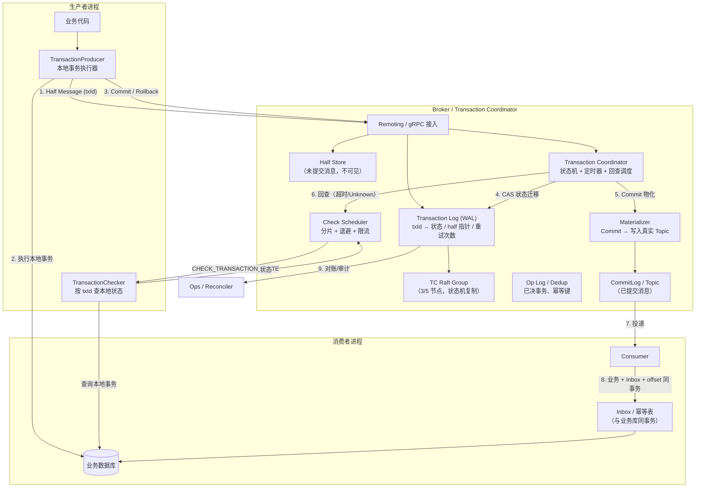
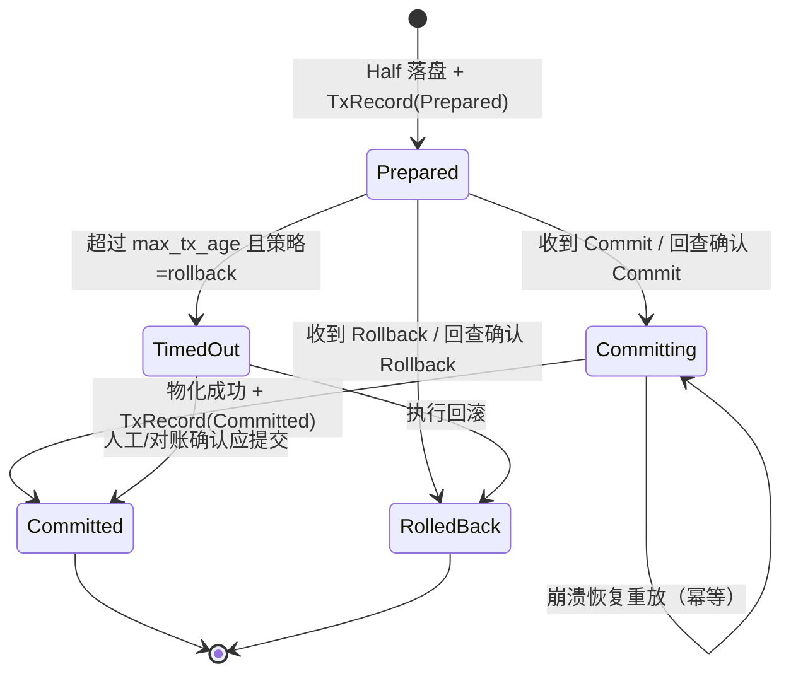
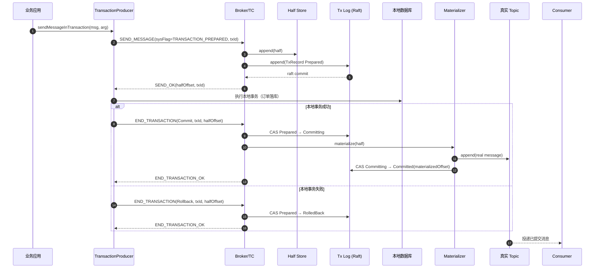
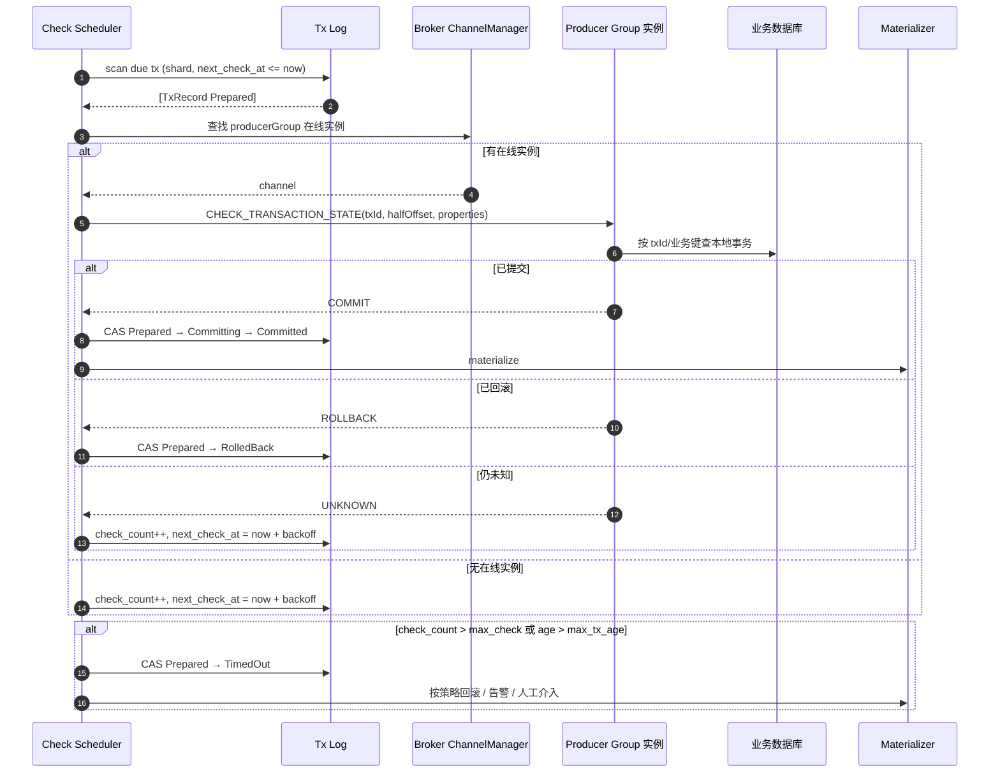
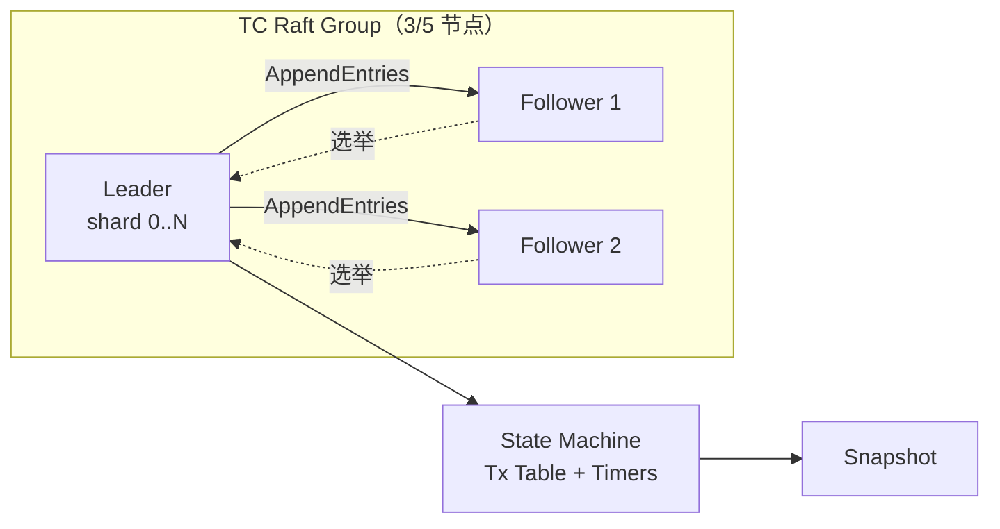
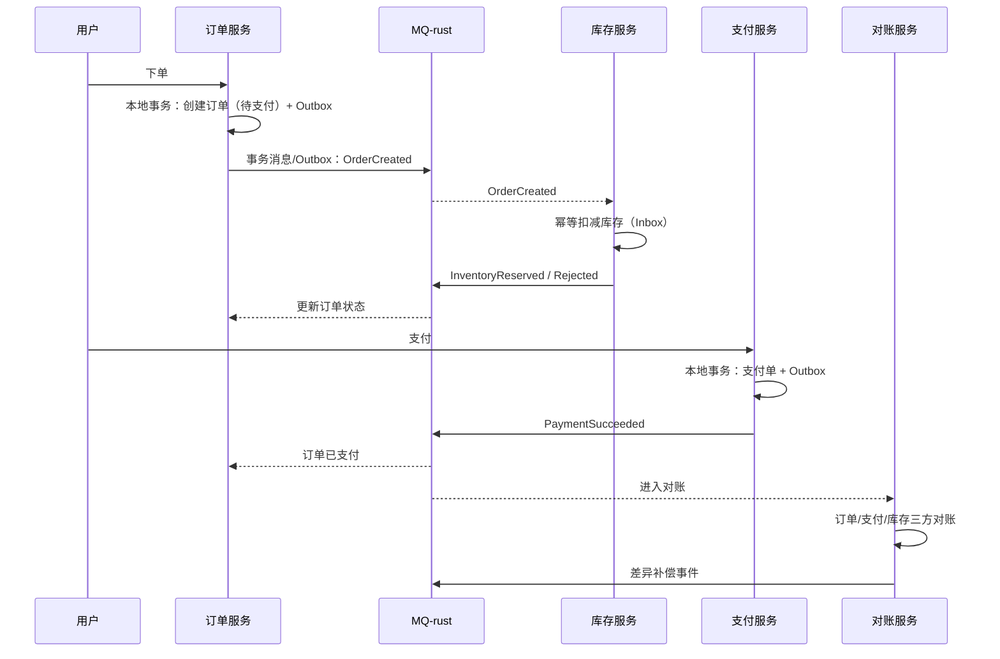

# 05 · 事务性设计：从 RocketMQ Half Message 到可审计的事务协调器

> 这是 MQ-rust 与“又一个 RocketMQ 复刻”的分水岭。  
> 目标不是宣称“端到端 exactly-once”，而是把**本地事务与消息发送的最终一致**做成可验证、可回查、可审计、可对账的一等公民。

---

## 1. 语义边界（先诚实，再设计）

| 场景 | MQ-rust 承诺 | 不承诺 |
|---|---|---|
| 生产者本地事务 ↔ 消息发送 | **最终一致**：本地事务成功 ⇒ 消息最终可见；失败 ⇒ 消息最终不可见 | 强一致、瞬时一致 |
| 消息投递 | **至少一次**（at-least-once） | 默认不保证 exactly-once |
| 消费副作用 | 提供幂等 SDK/Inbox，支持“处理 + 位点”同事务 | 不承诺跨任意服务的 exactly-once |
| 顺序 | 同一 queue 内顺序 | 跨 queue / 全局顺序 |
| 事务隔离 | 半消息不可见；提交后可见 | 未提交事务的中间状态对下游不可见，但业务侧可能有中间态 |
| 跨系统（DB + MQ + HTTP） | 通过 Outbox/Inbox + 对账达到最终一致 | 不把 HTTP/第三方系统纳入同一个 ACID 事务 |

**一句话**：MQ-rust 的事务消息解决“**消息不要凭空消失，也不要凭空出现**”；消费侧的一致性由“至少一次 + 幂等 + 对账”保证。

---

## 2. 总体架构



### 2.1 组件职责

| 组件 | 职责 | 关键点 |
|---|---|---|
| **Half Store** | 保存未提交消息体与属性 | 消费者不可见；与 tx log 同批落盘 |
| **Transaction Log** | 事务状态机、half 指针、重试次数、时间戳、审计 | 唯一真相；可重放；Raft 复制 |
| **Transaction Coordinator (TC)** | 状态迁移、超时、回查调度、物化协调 | 无状态计算 + 有状态日志；可分片 |
| **Materializer** | Commit 后把消息写入真实 Topic | 幂等；崩溃可重放 |
| **Check Scheduler** | 按 txId 分片扫描到期事务，向 Producer Group 回查 | 退避、限流、批量、避免风暴 |
| **Op Log / Dedup** | 记录已决事务、幂等键 | 防重复 commit/rollback；可压缩 |
| **Reconciler** | 事务日志 ↔ 业务状态对账 | 发现“已提交未物化/已物化未记录/长期未决” |

---

## 3. 数据模型

### 3.1 事务日志记录

```rust
pub struct TxRecord {
    pub tx_id: TxId,                 // 客户端提供或 broker 生成
    pub producer_group: String,
    pub topic: String,
    pub queue_id: i32,
    pub half_offset: u64,            // Half Store 物理偏移
    pub half_size: u32,
    pub half_crc32: u32,
    pub state: TxState,              // Prepared/Committing/Committed/RolledBack/TimedOut
    pub created_at_ms: i64,
    pub updated_at_ms: i64,
    pub next_check_at_ms: i64,
    pub check_count: u16,
    pub last_check_at_ms: Option<i64>,
    pub materialized_offset: Option<u64>,
    pub error: Option<String>,
    pub version: u64,                // CAS/乐观锁
    pub checksum: u32,
}

pub enum TxState {
    Prepared,      // half 已落盘，等待本地事务结果
    Committing,    // 已决定提交，物化中（崩溃恢复用）
    Committed,     // 已物化，消息可见
    RolledBack,    // 已回滚，消息不可见
    TimedOut,      // 超时，按策略处理（默认回滚）
}
```

**不变式**：
1. 任何 `Committed` 记录必须有 `materialized_offset`，且对应真实 Topic 消息可读。
2. 任何 `Committing` 记录在恢复时必须继续物化，不能停留在中间态。
3. `Prepared` 记录超过 `max_tx_age` 必须进入 `TimedOut` 或触发人工介入。
4. `tx_id` 在 `(producer_group, tx_id)` 维度唯一；重复 Half 返回已有记录。

### 3.2 Half Store 布局

```text
tx/
├── half/
│   ├── 00000000000000000000   # 追加写：txId + 属性 + body + CRC
│   └── ...
├── txlog/
│   ├── 00000000000000000000   # 事务日志（WAL，Raft 复制）
│   └── ...
├── op/
│   └── 00000000000000000000   # 已决事务索引，支持压缩
└── snapshot/
    └── tx-<index>.snap        # TC 状态机快照
```

**写入原子性**：Half 消息与 `TxRecord(Prepared)` 在同一个 `append_batch` 中落盘；要么都成功，要么都失败。若 Half 成功而 txlog 失败，启动时通过 Half 尾部扫描补建 `Prepared` 记录（Half 自带 txId）。

### 3.3 真实消息的物化

Commit 时，Materializer 从 Half Store 读取消息体，写入真实 Topic 的 CommitLog，得到 `materialized_offset`，然后：

1. 追加 `TxRecord(Committing, materialized_offset)`；
2. 写入真实消息（可见）；
3. 追加 `TxRecord(Committed)`；
4. 追加 Op 记录，允许后续清理 Half。

崩溃恢复：
- 若只有 `Committing`，比较真实 Topic 是否已有该 `tx_id`（Dedup 表/消息属性），有则补 `Committed`，无则重放物化。
- 若只有 `Prepared` 但业务已提交，回查后走 Commit。

> 与 RocketMQ 的差异：RocketMQ 把 Half 放在 `RMQ_SYS_TRANS_HALF_TOPIC` 的 CommitLog 中，Commit 时“恢复”到真实 Topic；MQ-rust 将 Half 独立存储、txlog 独立 WAL，便于审计、分片与清理。协议层仍保持 Half Topic 的语义与 Java SDK 行为一致。

---

## 4. 状态机



**允许的迁移**（CAS）：

| From | To | 触发 | 幂等 |
|---|---|---|---|
| Prepared | Committing | Commit | 重复 Commit 若已 Committed，直接返回成功 |
| Prepared | RolledBack | Rollback | 重复 Rollback 返回成功 |
| Prepared | TimedOut | 超时 | 只允许一次 |
| Committing | Committed | 物化完成 | 重复完成无副作用 |
| TimedOut | Committed | 对账/人工 | 需审计 + 二次确认 |
| TimedOut | RolledBack | 执行回滚 | 幂等 |

**禁止**：`Committed → RolledBack`、`RolledBack → Committed`（除非走“补偿事务”，生成新 txId，不修改历史）。

---

## 5. 正常流程（Commit）



**时延分解**（优化目标）：
- Half 写入 + Raft 复制：~1 RTT + fsync；
- 本地事务：业务决定；
- Commit 状态迁移 + 物化：可与 END_TRANSACTION 响应异步化（返回“已接受”，由 TC 完成），但 Java SDK 语义要求 Commit 后可见，因此首版同步物化，后续可提供 `asyncCommit` 扩展。

---

## 6. 回查流程（Check-back）

### 6.1 触发条件

1. Producer 执行本地事务后返回 `UNKNOWN`；
2. Producer 在发送 Half 后崩溃/断网，未发 END_TRANSACTION；
3. END_TRANSACTION 丢失/超时；
4. TC 状态为 `Prepared` 且超过 `first_check_delay`。

### 6.2 时序



### 6.3 回查策略

| 参数 | 默认（建议） | 说明 |
|---|---|---|
| `first_check_delay` | 6s | Half 后首次回查延迟（对齐 RocketMQ `transactionTimeOut`） |
| `check_interval` | 30s（5.3+）/ 60s（4.9） | 基础间隔；版本差异需可配 |
| `max_check` | 15 | 对齐 `transactionCheckMax` |
| `max_tx_age` | 4h（5.x 上限） | 超过则强制处理 |
| `backoff` | 指数退避 + jitter | 1.5×，上限 5min，防风暴 |
| `check_concurrency` | 按 TC 分片/租户限流 | 防止打满 Producer |
| `on_max_check` | `rollback + audit` | 可配 `alert_only`/`manual` |
| `on_timeout` | `rollback + audit` | 金融场景建议 `manual` 或 `compensate` |

**防回查风暴**：
- 按 `hash(txId)` 分片到多个 TC；每个 TC 只扫自己的分片。
- 扫描使用时间轮/最小堆，不扫全表。
- 同一 Producer Group 的回查请求做令牌桶限流。
- 批量回查：一次请求携带多个 txId（扩展协议，Java SDK 不兼容时仅内部使用）。
- 对“长期 Unknown”的 Producer 降级：减少回查频率，转人工/对账。

---

## 7. 超时与异常处理

| 异常 | 处理 | 审计 |
|---|---|---|
| Producer 崩溃（Half 后） | 回查同组其他实例；无实例则到期回滚 | `tx_timeout` |
| Producer 崩溃（本地事务提交后、END 前） | 回查 DB 确认 Commit，物化 | `tx_check_commit` |
| END 丢失 | 回查；Producer 重试 END 幂等 | `tx_duplicate_end` |
| Broker 崩溃（Half 落盘后） | 重启恢复 TxRecord；继续回查 | `tx_recover` |
| Broker 崩溃（Committing 中） | 恢复重放物化；Dedup 防重 | `tx_recover_materialize` |
| TC leader 崩溃 | Raft 选主；新 leader 接管分片；未决事务继续 | `tc_leader_change` |
| 网络分区 | 少数派拒写；Producer 回查走可用 TC；fencing | `tx_partition` |
| 时钟跳变 | 使用单调时钟 + 逻辑版本；`created_at` 仅审计 | `clock_skew_detected` |
| DB 不可用（回查时） | 返回 UNKNOWN；退避；不提前回滚 | `tx_check_db_error` |
| 半消息长期堆积 | 告警；按 `max_tx_age` 清理；人工对账 | `tx_pending_age` |
| 重复 Commit/Rollback | CAS 幂等；返回成功 | — |
| 物化重复 | Dedup 表 + 真实消息属性 `txId` 唯一 | `tx_duplicate_materialize` |

---

## 8. 事务协调器高可用（TC Raft）



**设计要点**：
- TC 状态机只存事务元数据（`TxRecord`），不存消息体；消息体在 Half Store/CommitLog。
- Raft 日志复制 `TxRecord` 变更；`apply` 后更新内存索引 + 定时器。
- 分片：`shard = hash(tx_id) % shard_count`；每个 TC 节点负责一组 shard，leader 失效后由新 leader 重新分配。
- 定时器：`apply` 时插入时间轮；leader 切换后从 snapshot + log 重建。
- 幂等：状态机 `apply` 必须幂等；重复日志条目按 `(tx_id, version)` 去重。
- 读一致性：`END_TRANSACTION` 走 leader；查询可走 follower（stale read 需标注）。

**为什么不用“每条消息过 Raft”**：消息体吞吐太大，Raft 日志写放大不可接受。Raft 只承载**事务元数据/状态**；消息体走主从复制。

---

## 9. 幂等：生产、物化、消费

### 9.1 幂等生产

- 唯一键：`(producer_group, tx_id)`。
- 重复 Half：返回已有 `half_offset`，不重复写。
- 重复 Commit：若已 `Committed`，返回成功；不重复物化。
- 重复 Rollback：若已 `RolledBack`，返回成功。

### 9.2 幂等物化

- 真实消息属性写入 `__MQ_RUST_TX_ID__`。
- 物化前查 Dedup 表（`tx_id -> materialized_offset`）；存在则跳过。
- Dedup 表与 `TxRecord(Committed)` 同事务/同批写入。

### 9.3 幂等消费（Inbox）

```sql
-- 业务库中的 Inbox 表（与业务表同库）
CREATE TABLE mq_inbox (
  consumer_group VARCHAR(128) NOT NULL,
  topic          VARCHAR(255) NOT NULL,
  msg_id         VARCHAR(64)  NOT NULL,
  business_key   VARCHAR(128),
  consumed_at    TIMESTAMP    NOT NULL DEFAULT CURRENT_TIMESTAMP,
  PRIMARY KEY (consumer_group, topic, msg_id),
  UNIQUE KEY uk_business (consumer_group, business_key)
);
```

消费事务：

```text
BEGIN;
  INSERT INTO mq_inbox(consumer_group, topic, msg_id, business_key) VALUES (...);
  -- 若唯一键冲突：说明已消费，直接 COMMIT 并 ACK
  UPDATE order SET status = 'PAID' WHERE id = ?;
  UPDATE inventory SET ...;
  -- 位点与业务同事务（或使用本地消息表）
  INSERT INTO mq_consumer_offset(...) VALUES (...) ON DUPLICATE KEY UPDATE ...;
COMMIT;
ACK;
```

> Java SDK 用户无法直接改客户端事务，但可以在业务层用 Inbox 表 + 幂等键实现同样效果；MQ-rust 提供 SQL schema、代码生成与校验工具。

### 9.4 exactly-once 的边界

- **可以做到**：MQ-rust 内部“消费 → 处理 → 生产”在同一个事务日志/DB 事务内（consume-transform-produce），配合 Inbox/Outbox。
- **做不到**：跨任意第三方服务、跨 HTTP 调用、跨不同数据库的 exactly-once。
- **推荐表述**：“至少一次 + 幂等 + 对账”，而不是“端到端 exactly-once”。

---

## 10. 与电商/金融模式结合

### 10.1 订单-库存-支付



- **下单**：本地事务写订单 + Outbox（或 Half Message）；保证“订单落库 ↔ 事件发出”。
- **库存**：消费幂等（订单号 + 事件类型），扣减失败发 `Rejected`，触发订单取消/补偿。
- **支付**：支付单 + Outbox；回调幂等；对账兜底。
- **超时取消**：延时消息（30min）触发取消 + 库存回补；延时消息与业务状态机配合。

### 10.2 金融交易

- **账务**：借贷平衡、不可丢、可审计；使用同步双写 + 3 副本；事务消息只用于“记账指令与流水事件”的最终一致。
- **顺序**：同一账户/合约用同一 queue，顺序消费；跨账户不承诺全局顺序。
- **幂等**：以“业务流水号”为唯一键；Inbox + 对账。
- **审计**：事务日志不可篡改（WORM/对象存储归档）；所有 commit/rollback/超时/人工干预留痕。
- **合规**：保留期、访问控制、数据脱敏、双人复核。

### 10.3 模式选择

| 模式 | 适用 | MQ-rust 支持 |
|---|---|---|
| 事务消息（Half/Check） | 本地事务 + 发消息，跨服务最终一致 | ✅ 核心 |
| 本地消息表/Outbox | 业务库与消息强绑定，零侵入 MQ | ✅ SDK + CDC |
| Saga | 长流程、多服务补偿 | ✅ 事件 + 补偿主题 |
| TCC | 资金/库存等强预留 | ✅ 作为业务模式，MQ 只做事件通道 |
| 最大努力通知 | 弱一致通知 | ✅ 重试 + 对账 |
| XA/2PC | 强一致、短事务 | ❌ 不推荐；不纳入首版 |

---

## 11. 与 RocketMQ 协议/API 的映射

| RocketMQ 概念 | MQ-rust 实现 | 兼容要求 |
|---|---|---|
| `TransactionMQProducer` | 服务端支持 `SEND_MESSAGE` + `END_TRANSACTION` + `CHECK_TRANSACTION_STATE` | Java SDK 无感 |
| `RMQ_SYS_TRANS_HALF_TOPIC` | 内部 Half Store；元数据保留该名称 | 管理命令/监控可见 |
| `RMQ_SYS_TRANS_OP_HALF_TOPIC` | Op Log / Dedup | 管理命令可见 |
| `transactionId` | 客户端属性 `__transactionId__`；缺省用 `producerGroup + msgId` | 必须透传 |
| `LocalTransactionState` | `COMMIT/ROLLBACK/UNKNOWN` | 枚举值对齐 |
| `END_TRANSACTION` | 请求码 37；extFields：`transactionId`、`commitLogOffset`、`transactionState`、`producerGroup`、`topic`、`queueId` | 字段名/类型对齐 |
| `CHECK_TRANSACTION_STATE` | 请求码 39；Broker → Producer | 超时/重试语义对齐 |
| 回查参数 | `transactionCheckMax=15`、`transactionCheckInterval` 30/60s、`transactionTimeOut=6s`、5.x `max_tx_age=4h` | 可配置，默认对齐 |

> 具体字段名以 4.9.8 `EndTransactionRequestHeader` / `CheckTransactionStateRequestHeader` 为准；R1 会用抓包与源码逐字段核对。

---

## 12. 相比 RocketMQ 的改进

| 改进 | 价值 |
|---|---|
| **独立事务日志 + 状态机** | 不依赖全量扫描 Half Topic；状态可查询、可审计、可恢复 |
| **TC Raft 化** | 事务协调器高可用；leader 切换不丢未决事务 |
| **分片回查 + 退避 + 限流** | 避免回查风暴；大集群可控 |
| **提交/回滚/物化幂等** | 网络重试不产生重复消息 |
| **超时策略可配** | 金融场景可选“人工介入”而非自动回滚 |
| **内建 Inbox/Outbox/对账** | 把“至少一次 + 幂等”工程化，而不是交给每个业务团队 |
| **审计事件** | commit/rollback/超时/人工干预全留痕 |
| **可观测** | 事务年龄、未决数、回查 QPS/延迟、TC leader 等指标 |

---

## 13. 指标与告警

| 指标 | 类型 | 告警建议 |
|---|---|---|
| `mq_tx_half_total` | Counter | 突增/突降 |
| `mq_tx_commit_total` / `mq_tx_rollback_total` | Counter | 比例异常 |
| `mq_tx_pending` | Gauge | > 阈值持续 5min |
| `mq_tx_pending_age_seconds` | Histogram | P99 > 5min |
| `mq_tx_check_total` / `mq_tx_check_failed_total` | Counter | 失败率 > 1% |
| `mq_tx_check_latency_seconds` | Histogram | P99 > 1s |
| `mq_tx_timeout_total` | Counter | 突增 |
| `mq_tx_unknown_total` | Gauge | 持续增长 |
| `mq_tx_materialize_latency_seconds` | Histogram | P99 > 100ms |
| `mq_tx_duplicate_commit_total` | Counter | 异常增长 |
| `mq_tc_leader` | Gauge | 无 leader > 30s |
| `mq_tc_raft_apply_lag` | Gauge | > 1000 |
| `mq_tx_audit_write_failed_total` | Counter | > 0 |

**Dashboard**：事务总览（半消息/提交/回滚/未决）、回查（QPS/延迟/失败）、事务年龄分布、TC Raft、按 Topic/ProducerGroup 分解。

---

## 14. 测试矩阵

| 编号 | 场景 | 期望 |
|---|---|---|
| T01 | 本地事务提交 → Commit | 消费者可见，且仅一次 |
| T02 | 本地事务回滚 → Rollback | 消费者不可见 |
| T03 | Producer 在 Half 后崩溃 | 回查同组实例；最终 commit/rollback |
| T04 | Producer 在本地提交后、END 前崩溃 | 回查 DB，最终 commit |
| T05 | END 丢失/重复 | 幂等；不重复物化 |
| T06 | Broker 在 Half 落盘后崩溃 | 重启恢复；继续回查 |
| T07 | Broker 在 Committing 中崩溃 | 恢复重放物化；不重复 |
| T08 | TC leader 崩溃 | 新 leader 接管；未决事务继续 |
| T09 | 网络分区 | 少数派拒写；无脑裂 |
| T10 | 回查返回 UNKNOWN 多次 | 退避；达到 max_check 后按策略 |
| T11 | 超过 max_tx_age | 超时回滚/告警/审计 |
| T12 | 重复消费 | Inbox 去重；业务只执行一次 |
| T13 | 事务消息 TPS | ≥ 普通消息 70% |
| T14 | 半消息堆积 | 告警 + 清理策略 |
| T15 | 时钟跳变 | 不误判超时；审计记录 |
| T16 | 对账 | 发现差异并修复 |

---

## 15. 待决问题（R1 前必须拍板）

1. **Half 存储位置**：独立 Half Store vs 复用 CommitLog 的 Half Topic？首版建议独立，但需评估与 Java 管理命令的兼容。
2. **Commit 同步/异步**：Java SDK `commit()` 返回时是否必须已物化？首版同步，后续扩展。
3. **TC 部署形态**：内嵌 Broker vs 独立 TC 集群？首版内嵌（单机/小集群），生产独立。
4. **事务日志格式**：自定义二进制 vs protobuf？首版自定义 + CRC，预留 schema 版本。
5. **超时默认策略**：自动回滚 vs 人工介入？按场景配置，默认自动回滚 + 审计。
6. **Inbox 的落点**：业务库 vs MQ 内部去重表？首版提供业务库 schema + SDK；内部去重表用于消费位点。
7. **与 RocketMQ 半消息的兼容深度**：是否允许 Java `mqadmin` 查询 Half Topic？首版只保证行为兼容，管理命令逐步补齐。
