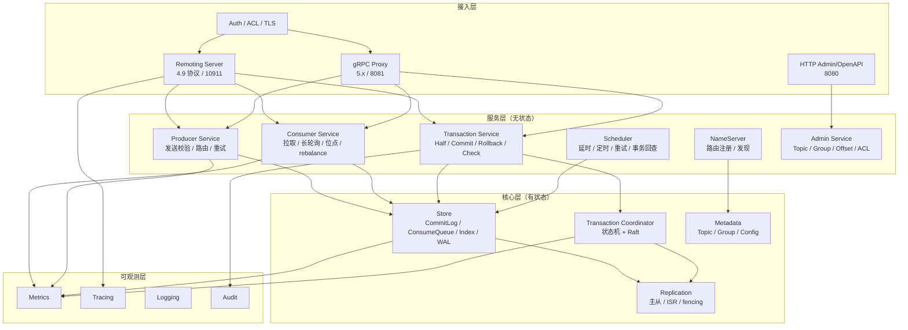
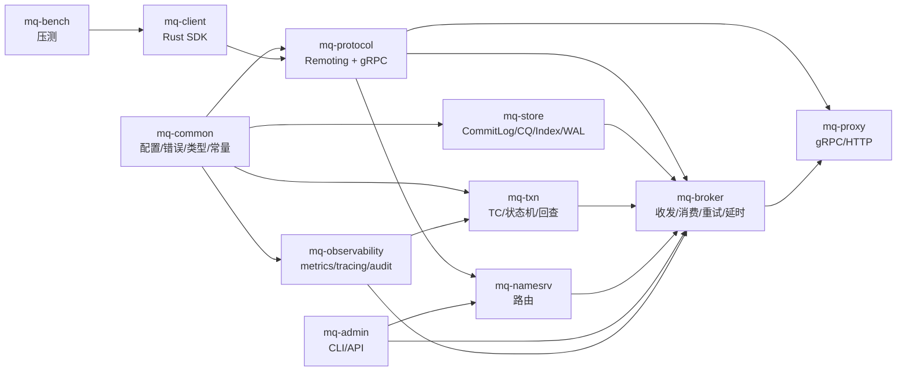
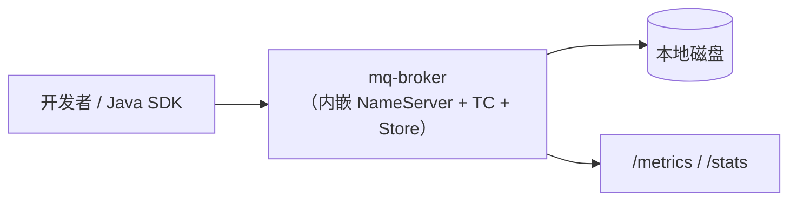
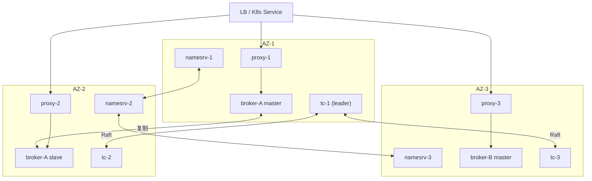
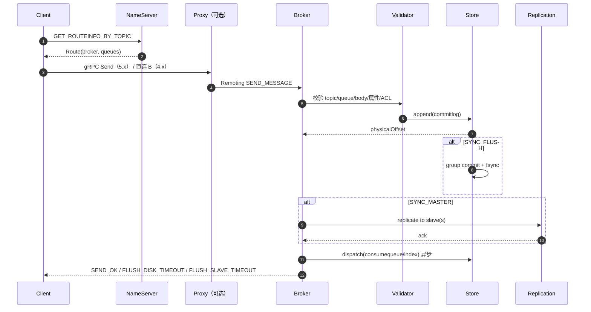
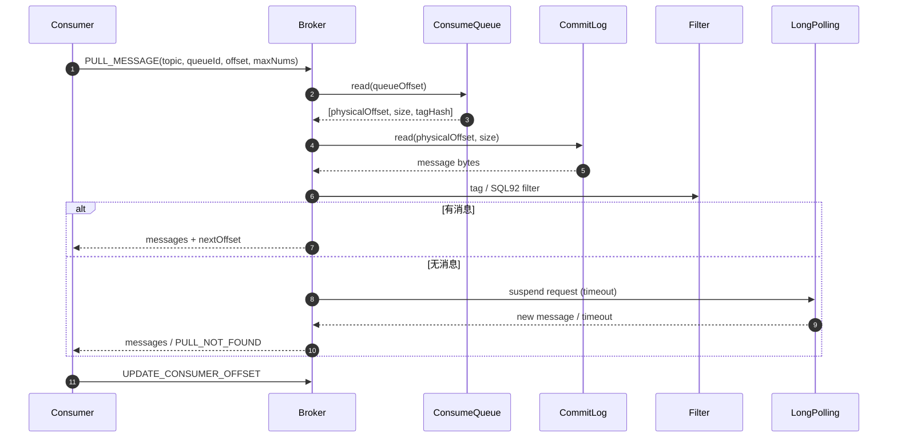
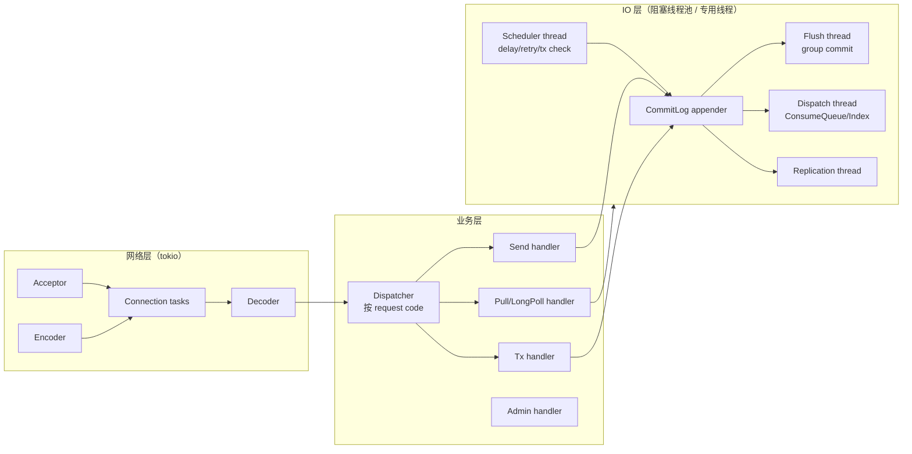

# 06 · 技术架构

> 目标：给出 MQ-rust 的**分层、Crate、部署、读写路径、线程模型与容量模型**，让实现者知道“代码放哪里、请求怎么走、瓶颈在哪”。

---

## 1. 分层架构



**原则**：
- 接入层只做协议/鉴权/限流，不写业务状态。
- 服务层无状态，可水平扩展；Broker 的“有状态”收敛到 Store/TXC/Replication。
- NameServer 与 Proxy 可独立扩缩容；Broker 按队列/副本扩缩容。

---

## 2. Crate 架构



| Crate | 职责 | 关键依赖 | 不做什么 |
|---|---|---|---|
| `mq-common` | 配置、错误、Topic/Queue 类型、常量、时间/ID | serde, thiserror, figment | 不依赖 tokio/网络 |
| `mq-protocol` | Remoting 帧/JSON header、gRPC proto、错误码 | serde_json, prost, bytes | 不碰存储 |
| `mq-store` | CommitLog/CQ/Index/WAL、刷盘、恢复、保留 | memmap2, positioned-io, crc32c | 不做协议/路由 |
| `mq-txn` | TC 状态机、事务日志、回查调度、对账 | openraft, mq-store | 不直接处理客户端连接 |
| `mq-namesrv` | Broker 注册、路由、心跳 | tokio, mq-protocol | 不存消息 |
| `mq-broker` | 发送/拉取/消费/重试/DLQ/延时/顺序 | mq-store, mq-txn, mq-protocol | 不做 gRPC 协议适配 |
| `mq-proxy` | gRPC/HTTP 接入、鉴权、转发 | tonic, axum, mq-protocol | 不持久化 |
| `mq-client` | Rust SDK：同步/异步/事务/批量 | tokio, mq-protocol | 不实现 Broker 逻辑 |
| `mq-observability` | metrics/tracing/audit 统一门面 | metrics, tracing, opentelemetry | 不含业务 |
| `mq-admin` | CLI/管理 API | clap, axum | 不绕过 Broker 直接改存储 |
| `mq-bench` | 压测器 | mq-client, hdrhistogram | 不参与生产 |

---

## 3. 部署拓扑

### 3.1 本地开发（单进程 / Local 模式）



- 单二进制 `mq-broker --local`，内嵌 NameServer/TC，便于 R1 开发。
- 默认异步刷盘、单副本；用于功能验证，不作为生产。

### 3.2 生产集群（推荐）



- **NameServer**：3 节点，跨 AZ；客户端配置全部地址。
- **Broker**：按 Topic/Queue 分片；每组 1 Master + 2 Slave（或 1+1 视成本）。
- **TC**：3/5 节点 Raft，独立部署；与 Broker 同 AZ 优先。
- **Proxy**：无状态，按 QPS 扩缩容；gRPC 入口。
- **存储**：本地 NVMe；跨 AZ 复制；冷数据下沉对象存储（P2）。

### 3.3 Kubernetes（R5）

- StatefulSet：Broker/TC/NameServer；Local PV 或 CSI。
- Operator：管理 Topic/Group/ACL/扩缩容/故障切换。
- Service：Proxy 无状态 Deployment；HPA 按 QPS/连接数。
- 注意：Broker 是有状态服务，不能用普通 Deployment 滚动；需 readiness + 分区升级。

---

## 4. 写路径（发送）



**关键路径优化**：
- 协议解码零拷贝：`Bytes` 切片，避免 body 复制。
- 校验轻量：Topic/Queue 缓存、ACL 缓存。
- 批量 append：客户端批量 + Broker 聚合。
- 刷盘组提交：独立 IO 线程，避免 async worker 阻塞。
- 复制流水线：批量 + 背压。

---

## 5. 读路径（消费）



**长轮询**：Push 消费在 Broker 侧挂起请求，消息到达或超时返回；避免客户端空转。挂起连接需要有上限、超时、连接隔离。

---

## 6. 线程 / IO 模型



**原则**：
- 网络/协议在 tokio；存储/fsync 在专用阻塞线程，避免阻塞 runtime。
- 每个 CommitLog 一个 appender 线程（或分段多 appender），顺序写。
- Flush 组提交：批量 fsync，降低 IOPS。
- Dispatch 独立线程/线程池，按 queue 并行；落后时背压。
- 事务回查/延时/重试共用一个分层时间轮，避免 N 个定时器。

**Windows 注意**：`fsync`/`FlushFileBuffers` 语义、mmap 关闭/删除文件行为与 Linux 不同；用 `platform` 模块封装，CI 双平台。

---

## 7. 存储布局与容量

### 7.1 目录

```text
data/
├── commitlog/                 # 1GB/文件，顺序写
├── consumequeue/<topic>/<qid> # 20B/条
├── index/                     # 哈希索引
├── tx/
│   ├── half/                  # 半消息
│   ├── txlog/                 # 事务 WAL
│   └── snapshot/              # TC 快照
├── delay/                     # 延时/定时索引
├── config/                    # topic/group/offset
└── checkpoint/
```

### 7.2 容量公式

```text
消息体容量 ≈ 日均消息数 × 平均大小 × 保留天数 × 副本数 × (1 + 索引/属性开销)
索引容量 ≈ 日均消息数 × 20B × 保留天数 × 副本数
事务容量 ≈ 日均事务数 × (TxRecord ~256B + Half 平均大小) × 保留天数
网络 ≈ 峰值 TPS × 平均消息大小 × 副本数 × 跨 AZ 系数
```

示例（1 亿条/天、1 KiB、7 天、3 副本）：
- 消息体 ≈ 1e8 × 1KiB × 7 × 3 ≈ 2.1 PB（未压缩）；压缩/去重后可显著下降。
- 索引 ≈ 1e8 × 20B × 7 × 3 ≈ 42 GB。
- 需按 Topic 冷热分层，避免全量 3 副本。

### 7.3 容量保护

- 磁盘水位：70% 告警、80% 限流、85% 只读、90% 强制清理（保护 hot 文件）。
- 保留策略：按时间 + 磁盘水位双阈值；`deleteWhen` 错峰。
- 冷读限流：避免回放打满 PageCache。
- 配额：按 tenant/topic 限制写入速率与存储。

---

## 8. 故障域与恢复

| 故障 | 影响 | 恢复 |
|---|---|---|
| Broker 进程崩溃 | 该节点不可用 | 重启恢复 CommitLog/CQ；Controller 切换 |
| 磁盘故障 | 单副本数据丢失 | 从 Slave 重建；RAID/多副本 |
| 网络分区 | 少数派不可写 | Raft 多数派；fencing |
| NameServer 全挂 | 新客户端无法发现 | 客户端缓存路由；恢复 NameServer |
| TC leader 挂 | 事务回查暂停 | Raft 选主；分片接管 |
| Proxy 挂 | 5.x 接入不可用 | LB 摘除；无状态重启 |
| 时钟跳变 | 超时误判 | 单调时钟 + 逻辑版本；审计 |

---

## 9. 技术架构的 10 条约束

1. **Broker 不依赖外部数据库**：元数据/位点/事务状态本地 WAL + Raft；避免额外 SPOF。
2. **NameServer 不持久化消息**：只做路由；可快速重建。
3. **Proxy 无状态**：不缓存消息体；只做协议转换/鉴权/转发。
4. **Store 是唯一写入口**：所有消息写入必须经过 CommitLog；禁止旁路。
5. **事务日志与消息日志分离**：TC 状态可独立复制/恢复。
6. **复制不经过 Raft**：消息体主从复制；元数据/事务状态 Raft。
7. **所有长耗时操作可取消/超时**：回查、长轮询、复制、刷盘。
8. **所有状态机可重放**：启动恢复、TC apply、物化。
9. **所有关键路径有指标**：没有指标等于没有实现。
10. **平台差异隔离**：Windows 保功能，Linux 保性能；零拷贝/io_uring 用 feature gate。
