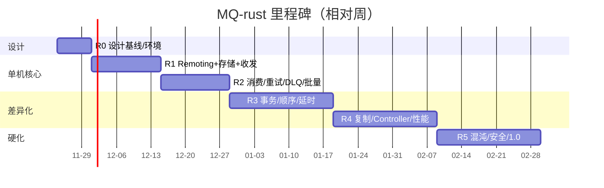
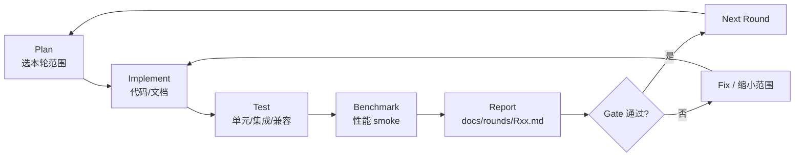

# 09 · 路线图与迭代计划

> 当前进度：R1-R10 完成；R12 TC TCP Raft；R13 Broker 按 TC 决策收口；R20 锁/写优化（8 队列 9,347 TPS）；R21 CQ/索引；R22 位点+元数据压缩；R24 Inbox；R26 K8s；R27 主从+重放+自动切换+ack；R30 最终评估；R31 回归；R32 原生栈复验；R33 一致性检查；R34 80 轮封版；R35 性能实验；R36 批量 64 条 24,982 msg/s；R37 并发一致性；R38 CQ 修复；R39 队列调优；R40 `/stats`+gauges；R41 崩溃恢复；R42 Retention；R44 路由栅栏；R45 Epoch 栅栏；R46 事件栅栏；R47 栅栏鉴权；R48 Admin 鉴权；R49 Broker Admin 鉴权；R50 100 轮里程碑；R51 批量扫描；R52 路由持久化；R54 原生复验；R55 AccessKey 原型；R56 Retention 指标；R57 Topic 统计；R58 同步复制 ACK；R59 全量回归；R60 Tag 稳定性；R61 `/version`；R62 缺口刷新；R63 交付终检；R64 验收矩阵；R65 环境终审；R66 最终差距；R67 Git 快照；R68 最终收口；R69 ACL Signature；R70 ACL 权限文件；R71 ACL 热更新；R72 ACL 来源 IP；R73 CQ 分段；R74 分段性能；R75 段大小配置；R76 Retention 段删；R77 ACL CIDR；R78 消息轨迹；R79 事务轨迹；R80 消费吞吐；R81 Group Commit（负结果）；R82 CQ 单次写；R83 Retention 崩溃恢复；R84 CommitLog 字节指标；R85 全量回归；R86 CommitLog 分段；R87 200k 压力；R88 CommitLog 段回收；R89 回收后写入；R90 双副本保留；R91 物理偏移修复；R92 1M 压力；R93 CQ 非对齐重写；R94 1M 复测；R95 Quorum 复制；R96 自动提升；R97 旧主 Fence；R98 双分片回归；R99 最终验收；R100 SDK 边界场景；R101 定时重启；R102 半事务重启；R103 超时回滚重启；R104 交付冻结；R105 分发包；R106 分发冒烟；R107 运维手册；R108 容器差距；R109 1.0 差距复核；R110 一致性复核；R111 交付索引；R112 迭代收口；R113 原生基线；R114 无保留 1M；R115 跳过复制编码；R116 Retention 调优；R117 容器清单修复；R118 mqadmin 兼容；R119 消费管理；R120 连接字段；R121 真实地址；R122 CQ 段调优；R123 topicList；R124 updateTopic；R125 deleteTopic；R126 订阅组列表；R127 订阅组 CRUD；R128 元数据持久化；R129 管理后回归；R130 轨迹持久化；R131 producer 连接；R132 SDK 矩阵；R133 traces 接口；R134 验收刷新；R135 交付说明；R136 分发包验证；R137 轨迹轮转；R138 一致性检查；R139 轨迹异步；R141 容器实测；R142 容器重启；R143 K8s 探针；R144 K8s TC；R145 K8s PVC；R146 容器矩阵；R147 完整 Compose；R148 ACL 组权限；R149 健康免鉴权；R150 batch128；R151 batch256；R152 交付冻结；R153 1.0 计划；R154 交付交接；R155 SSD 负结果；R156 批量合并负结果；R157 TLS；R158 mTLS；R159 轨迹开关；R160 Java mTLS；R161 gRPC；R162 gRPC TLS；R163 Raft 租约；R164 租约路由；R165 容器镜像；R166 镜像 SDK；R167 完整矩阵；R168 Inbox；R169 Grafana；R170 gRPC TxStatus；R171 K8s 双节点；R172 集群内 SDK；R173 RC 验收关闭；R175 mq-raft 原型；5 万 TPS/严格防脑裂/Docker 实测仍待完成。证据见 [R01](rounds/R01.md)、[R02](rounds/R02.md)、[R03](rounds/R03.md)、[R04](rounds/R04-perf.md)、[R05](rounds/R05-delay.md)、[R06](rounds/R06-order.md)、[R07](rounds/R07-tc.md)、[R08](rounds/R08-acceptance.md)、[R09](rounds/R09-tc-integration.md)、[R10](rounds/R10-native-deploy.md)、[R12](rounds/R12-tc-tcp.md)、[R13](rounds/R13-broker-tc-decision.md)、[R20](rounds/R20-lock-optimization.md)、[R21](rounds/R21-consumequeue.md)、[R22](rounds/R22-offset-persistence.md)、[R24](rounds/R24-inbox.md)、[R25](rounds/R25-regression2.md)、[R27](rounds/R27-broker-replication.md)、[R30](rounds/R30-final.md)、[R31](rounds/R31-final-regression.md)、[R32](rounds/R32-native-final.md)、[R33](rounds/R33-consistency.md)、[R34](rounds/R34-final-80.md)、[R35](rounds/R35-perf-experiments.md)、[R36](rounds/R36-batch-performance.md)、[R37](rounds/R37-concurrency.md)、[R38](rounds/R38-cq-repair.md)、[R39](rounds/R39-queue-tuning.md)、[R40](rounds/R40-admin-stats.md)、[R41](rounds/R41-crash-recovery.md)、[R42](rounds/R42-retention.md)、[R44](rounds/R44-router-fencing.md)、[R45](rounds/R45-epoch-fencing.md)、[R46](rounds/R46-event-fencing.md)、[R47](rounds/R47-fence-token.md)、[R48](rounds/R48-admin-auth.md)、[R49](rounds/R49-broker-admin-auth.md)、[R50](rounds/R50-milestone-100.md)、[R51](rounds/R51-batch-sweep.md)、[R52](rounds/R52-route-persistence.md)、[R54](rounds/R54-native-revalidation.md)、[R55](rounds/R55-acl-prototype.md)、[R56](rounds/R56-retention-metric.md)、[R57](rounds/R57-topic-stats.md)、[R58](rounds/R58-sync-replication.md)、[R59](rounds/R59-full-regression.md)、[R60](rounds/R60-tag-stability.md)、[R61](rounds/R61-version-endpoint.md)、[R62](rounds/R62-readme-gaps.md)、[R63](rounds/R63-delivery-consistency.md)、[R64](rounds/R64-acceptance-matrix.md)、[R65](rounds/R65-environment-audit.md)、[R66](rounds/R66-final-gap.md)、[R67](rounds/R67-git-snapshot.md)、[R68](rounds/R68-final-closure.md)、[R69](rounds/R69-acl-signature.md)、[R70](rounds/R70-acl-policy.md)、[R71](rounds/R71-acl-hot-reload.md)、[R72](rounds/R72-acl-ip.md)、[R73](rounds/R73-cq-segments.md)、[R74](rounds/R74-segmented-cq-perf.md)、[R75](rounds/R75-cq-segment-config.md)、[R76](rounds/R76-retention-segment-drop.md)、[R77](rounds/R77-acl-cidr.md)、[R78](rounds/R78-message-trace.md)、[R79](rounds/R79-tx-trace.md)、[R80](rounds/R80-consumer-throughput.md)、[R81](rounds/R81-group-commit.md)、[R82](rounds/R82-cq-single-write.md)、[R83](rounds/R83-retention-crash.md)、[R84](rounds/R84-commitlog-metric.md)、[R85](rounds/R85-regression.md)、[R86](rounds/R86-commitlog-segments.md)、[R87](rounds/R87-stress-retention.md)、[R88](rounds/R88-commitlog-trim.md)、[R89](rounds/R89-post-trim-append.md)、[R90](rounds/R90-replication-retention.md)、[R91](rounds/R91-physical-offset-fix.md)、[R92](rounds/R92-million-stress.md)、[R93](rounds/R93-cq-unaligned-rewrite.md)、[R94](rounds/R94-million-retest.md)、[R95](rounds/R95-quorum-replication.md)、[R96](rounds/R96-auto-failover.md)、[R97](rounds/R97-fence-old-master.md)、[R98](rounds/R98-final-functional.md)、[R99](rounds/R99-final-report.md)、[R100](rounds/R100-sdk-edge-modes.md)、[R101](rounds/R101-startdeliver-restart.md)、[R102](rounds/R102-tx-half-restart.md)、[R103](rounds/R103-tx-timeout-restart.md)、[R104](rounds/R104-delivery-freeze.md)、[R105](rounds/R105-dist-package.md)、[R106](rounds/R106-dist-smoke.md)、[R107](rounds/R107-runbook.md)、[R108](rounds/R108-container-gap.md)、[R109](rounds/R109-gap-review.md)、[R110](rounds/R110-final-consistency.md)、[R111](rounds/R111-delivery-index.md)、[R112](rounds/R112-iteration-close.md)、[R113](rounds/R113-native-baseline.md)、[R114](rounds/R114-no-retention-1m.md)、[R115](rounds/R115-replica-skip.md)、[R116](rounds/R116-retention-tuning.md)、[R117](rounds/R117-compose-k8s-fix.md)、[R118](rounds/R118-mqadmin-202-203.md)、[R119](rounds/R119-consumer-admin.md)、[R120](rounds/R120-consumer-connection-fields.md)、[R121](rounds/R121-consumer-address.md)、[R122](rounds/R122-cq-segment-tuning.md)、[R123](rounds/R123-topic-list.md)、[R124](rounds/R124-update-topic.md)、[R125](rounds/R125-delete-topic.md)、[R126](rounds/R126-subscription-groups.md)、[R127](rounds/R127-subscription-group-crud.md)、[R128](rounds/R128-admin-meta-persistence.md)、[R129](rounds/R129-admin-regression.md)、[R130](rounds/R130-trace-persistence.md)、[R131](rounds/R131-producer-connection.md)、[R132](rounds/R132-sdk-matrix.md)、[R133](rounds/R133-traces-api.md)、[R134](rounds/R134-final-acceptance-refresh.md)、[R135](rounds/R135-release-notes.md)、[R136](rounds/R136-distcheck.md)、[R137](rounds/R137-trace-rotation.md)、[R138](rounds/R138-release-consistency.md)、[R139](rounds/R139-trace-async.md)、[R141](rounds/R141-containers.md)、[R142](rounds/R142-container-restart.md)、[R143](rounds/R143-k8s-probes.md)、[R144](rounds/R144-k8s-tc-leader.md)、[R145](rounds/R145-k8s-broker-pvc.md)、[R146](rounds/R146-container-sdk-matrix.md)、[R147](rounds/R147-full-compose.md)、[R148](rounds/R148-acl-group.md)、[R149](rounds/R149-health-auth.md)、[R150](rounds/R150-batch128.md)、[R151](rounds/R151-batch256.md)、[R152](rounds/R152-delivery-freeze.md)、[R153](22-1.0剩余工作计划.md)、[R154](23-交付交接.md)、[R155](rounds/R155-ssd-negative.md)、[R156](rounds/R156-batch-merge-negative.md)、[R157](rounds/R157-tls.md)、[R158](rounds/R158-mtls.md)、[R159](rounds/R159-trace-toggle.md)、[R160](rounds/R160-java-mtls.md)、[R161](rounds/R161-grpc.md)、[R162](rounds/R162-grpc-tls.md)、[R163](rounds/R163-raft-lease.md)、[R164](rounds/R164-lease-route.md)、[R165](rounds/R165-container-image.md)、[R166](rounds/R166-image-sdk.md)、[R167](rounds/R167-image-matrix.md)、[R168](rounds/R168-inbox-container.md)、[R169](rounds/R169-grafana.md)、[R170](rounds/R170-grpc-txstatus.md)、[R171](rounds/R171-k8s-multinode.md)、[R172](rounds/R172-k8s-incluster-sdk.md)、[R173](rounds/R173-rc-acceptance.md)、[R175](rounds/R175-mq-raft-prototype.md)。

> 策略：**小步快跑、每轮可验收、每轮有性能与文档**。  
> 现实约束：当前是单人 + AI Agent 的执行环境，且 Windows 开发机没有 Docker/WSL；因此把“功能 1.0”和“生产就绪”分开承诺。

---

## 1. 两条时间线

| 时间线 | 目标 | 人力假设 | 周期 |
|---|---|---|---|
| **A. Agent 执行线** | 功能闭环、可演示、可测试、文档齐全 | 1 Agent + 人工验收 | 12-16 周（R0-R5） |
| **B. 生产就绪线** | 万亿级容量、跨 AZ、金融级审计、SLA | 6-8 人（Rust/存储/SRE/测试） | 24-30 周 |

> 本文件的 R0-R5 以 A 线为节奏；B 线在 R4 后引入性能/混沌/安全专项。任何“1:1 生产级”承诺都必须以 B 线的验收为准。

---

## 2. 里程碑总览

> 日期是乐观计划；每轮结束按实际进度重排。生产级 1.0 建议在此基础上增加 8-12 周的性能/混沌/安全专项。

---

## 3. 轮次定义

### R0 · 设计基线（当前）

**目标**：把“做什么、为什么、怎么验收”写成可执行文档；准备环境与基线。

| 交付 | 验收 |
|---|---|
| NSQ/RocketMQ 架构分析 | 文档含事实来源、图示、取舍 |
| 功能图谱/关注点/事务设计 | 评审通过；无自相矛盾 |
| Rust 选型/技术架构/实现方案 | Crate 边界清晰；关键算法可落地 |
| 路线图/测试/性能/监控 | 每轮有 Gate 与证据链 |
| G:\MQ_soft 环境 | JDK/Maven/RocketMQ 可启动；Docker 缺失有替代方案 |
| 第一轮记录 | 命令、输出、问题、下一步 |

**性能**：R0 只做 Java RocketMQ 基线（启动、收发 smoke），不承诺 MQ-rust 数字。

---

### R1 · 单机核心（Remoting + 存储 + 收发）

**目标**：Java 4.9.8 SDK 能连上 MQ-rust，发送并拉取普通消息；重启不丢。

| 交付 | 验收 |
|---|---|
| `mq-common`/`mq-protocol`/`mq-store`/`mq-namesrv`/`mq-broker` | `cargo build --release` 双平台 |
| Remoting codec | 与 Java 抓包 golden 一致 |
| CommitLog/ConsumeQueue/恢复 | 杀进程重启，消息可读；CQ 可重建 |
| NameServer 路由 | Java `getRouteInfo` 成功 |
| SEND/PULL/心跳 | Java `DefaultMQProducer` + `DefaultMQPullConsumer` |
| `/metrics` + 日志 | 关键指标可见 |
| R1 报告 | `docs/rounds/R01.md` |

**性能 Gate**：单机 1 KiB、异步刷盘、单副本，发送 ≥ 3 万 TPS，P99 < 50 ms（开发机基线，不对外）。

**风险**：协议字段/错误码不匹配；Windows mmap/文件轮转。

---

### R2 · 消费与基础功能

**目标**：Push 消费、位点、重试、DLQ、批量、Tag 过滤、Index、Admin、可观测。

| 交付 | 验收 |
|---|---|
| Push 消费 + 长轮询 | Java `DefaultMQPushConsumer` 端到端 |
| 位点查询/提交/重置 | 集群/广播模式 |
| Rebalance | 消费者上下线，queue 不重复 |
| 重试/DLQ | 失败重试；超限进 `%DLQ%group` |
| 批量消息 | 批量发送/消费；4MB 限制 |
| Tag/SQL92 过滤 | Java SDK 过滤器 |
| IndexFile | 按 key/时间查询 |
| Admin API/CLI | topic/group/offset/status |
| Prometheus + Dashboard | 集群/Broker/Topic/Group |
| R2 报告 | 含性能对比 |

**性能 Gate**：1 KiB、异步刷盘、单副本，发送 ≥ 8 万 TPS，消费 ≥ 6 万 TPS，P99 < 30 ms。

---

### R3 · 事务 / 顺序 / 延时（差异化）

**目标**：六类消息中最重要的三类可用；`TransactionMQProducer` 通过。

| 交付 | 验收 |
|---|---|
| 半消息 + 事务日志 + Op | 未提交不可见；重启恢复 |
| Commit/Rollback | 物化/丢弃；重复幂等 |
| 回查 | 杀 Producer 后同组回查；最终一致 |
| 超时策略 | 超时回滚/审计 |
| TC 内嵌模式 | 单机/小集群可用 |
| 顺序消息 | 同 queue 严格顺序；失败阻塞 |
| 延时消息 | 4.x 18 级；5.x 任意时间（P1） |
| 事务 Java SDK 兼容 | `TransactionMQProducer` 全链路 |
| 事务 Dashboard | 半消息/提交/回滚/未决/回查 |
| R3 报告 | 含故障注入结果 |

**性能 Gate**：事务消息 TPS ≥ 普通消息 70%；回查 P99 < 1s（1000 未决）。

---

### R4 · 复制 / Controller / gRPC / 性能

**目标**：3 节点集群可故障切换；5.x SDK 通过 Proxy；性能达到工程目标。

| 交付 | 验收 |
|---|---|
| 主从异步/同步复制 | Slave 可读；同步双写不丢 |
| Controller（openraft） | 单节点故障 RTO < 30s；fencing |
| TC Raft | leader 故障切换；未决事务继续 |
| gRPC Proxy | 5.3+ Java SDK 收发 |
| 性能优化 | 批量、组提交、零拷贝、锁分片 |
| 容量/冷读/保留 | 磁盘水位、清理、冷读限流 |
| 安全基础 | ACL/TLS（P1） |
| R4 报告 | 3 节点性能/故障报告 |

**性能 Gate**：3 副本、同步刷盘，发送 ≥ 5 万 TPS，P99 < 20 ms；异步 ≥ 20 万 TPS。

---

### R5 · 硬化与 1.0

**目标**：混沌、对账、审计、容器化、验收清单全绿；发布 1.0。

| 交付 | 验收 |
|---|---|
| 20+ 混沌场景 | 进程/磁盘/网络/时钟/副本 |
| Inbox/Outbox/对账 | 重复消费不重复副作用；差异可修复 |
| 审计/合规 | commit/rollback/超时/人工留痕 |
| 容器化 | docker-compose/K8s 清单；CI 可跑 |
| 升级/回滚/迁移 | 演练通过 |
| 文档/手册 | 部署、运维、开发、FAQ |
| 验收清单 | `10-测试与验收` 全绿 |
| 1.0 发布 | tag + release notes |

**性能 Gate**：达到 `11-性能基准` 的全部目标；报告可复现。

---

## 4. 每轮执行协议（Agent 工作流）

### 4.1 每轮必须产出

1. **代码**：可构建、可运行、有测试。
2. **测试报告**：命令 + 输出摘要 + 失败分析。
3. **性能 smoke**：即使功能轮也要跑一次基准（可用小规模）。
4. **文档**：`docs/rounds/Rxx.md`，含：
   - 本轮目标与范围；
   - 完成项/未完成项；
   - 关键决策/变更；
   - 性能数据（硬件、参数、负载）；
   - 问题与风险；
   - **下一轮建议**（必须具体到任务）。
5. **更新**：README 状态、路线图、功能矩阵。

### 4.2 Gate 规则

- Gate 不通过：**不允许**进入下一轮“新功能”，只能修复/补测试/缩范围。
- 连续 2 轮同一 Gate 失败：升级为风险，重排路线图。
- 任何性能数字缺少环境说明：视为无效。
- 任何“已完成”功能缺少证据链：视为未完成。

---

## 5. 验收 Gate（与功能清单对应）

| Gate | 内容 | 通过标准 |
|---|---|---|
| **G0** | 设计基线 | 文档评审通过；环境可用 |
| **G1** | 单机收发 | Java 4.9.8 发送/拉取；重启恢复 |
| **G2** | 消费与基础功能 | Push/位点/重试/DLQ/批量/过滤/Admin |
| **G3** | 事务/顺序/延时 | 事务全链路 + 故障注入；顺序；延时 |
| **G4** | 高可用/性能 | 3 节点切换；性能目标；gRPC |
| **G5** | 1.0 | 混沌/安全/对账/容器/文档全绿 |

---

## 6. 资源与环境计划

| 资源 | 当前 | 计划 |
|---|---|---|
| 开发机 | Windows，i5-4210M，16GB? | 功能开发；性能数据仅作 smoke |
| 性能机 | 待定 | Linux，16C/32G/SSD，1Gbps+ |
| Java | JDK 17.0.2（G:\MQ_soft） | 固定；RocketMQ 4.9.8 |
| Maven | 3.9.16（下载中） | 构建 Java 兼容测试 |
| Docker | **缺失** | 优先安装 Docker Desktop/WSL2；否则用 Linux CI + native harness |
| RocketMQ | 4.9.8（下载中） | 兼容基线；5.3+ 后续 |
| 监控 | Prometheus/Grafana | R2 起容器化或本机 |
| CI | 待建 | GitHub Actions/GitLab CI：Linux + Windows |

> 如果 Docker 无法在开发机安装：交付 `deploy/docker-compose.yml` 与 K8s 清单，在 Linux CI/云主机执行容器化测试；本机用 `deploy/native` 脚本跑等价场景。**这不降低验收标准，只改变执行位置。**

---

## 7. 风险与缓冲

| 风险 | 影响 | 缓冲 |
|---|---|---|
| 协议兼容反复 | R1 延期 | 先做 golden/抓包；必要时参考 rocketmq-rust 测试用例 |
| 事务状态机复杂 | R3 延期 | 先单机内嵌 TC；Raft 后置 |
| 性能不达标 | R4 延期 | 先保证功能；性能专项 2 周 |
| Docker 不可用 | 容器化验收受阻 | Linux CI/云主机；native 兜底 |
| 单人精力 | 全盘延期 | 每轮缩小范围；P0 优先 |
| 生产级 1:1 预期 | 预期落差 | 明确 A/B 线；1.0 只承诺文档中的验收项 |

---

## 8. 下一轮（R1）具体任务

1. 初始化 Cargo workspace 与 5 个核心 crate。
2. 实现 Remoting 帧/JSON header/命令常量 + golden 测试。
3. 实现 CommitLog（1GB 文件、追加、恢复）+ ConsumeQueue（20B）。
4. 实现 NameServer 注册/路由 + Broker 注册。
5. 实现 `SEND_MESSAGE`/`PULL_MESSAGE`/`HEART_BEAT`。
6. 用 Java 4.9.8 SDK 跑通发送/拉取。
7. `/metrics` + 结构化日志。
8. 跑 R1 性能 smoke 并写 `docs/rounds/R01.md`。
9. 更新功能矩阵与 README 状态。

> 完成 R1 后，按本文“每轮执行协议”自动进入 R2；若 Gate 失败，先修复，不跳轮。
