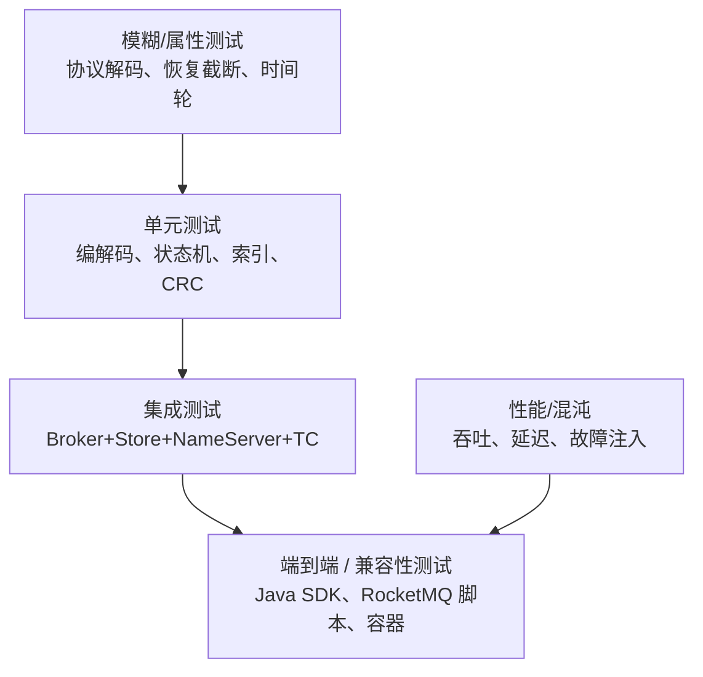

# 10 · 测试与验收

> 原则：**没有证据链的功能 = 未完成**。  
> 每轮测试必须可复现：命令、配置、版本、硬件、输出、结论缺一不可。

---

## 1. 测试金字塔



| 层 | 工具 | 频率 |
|---|---|---|
| 单元 | `cargo test`、`proptest`、`insta` | 每次提交 |
| 集成 | `cargo test --test integration` | 每次提交/每日 |
| 兼容 | Java 4.9.8 SDK + `mqadmin` + RocketMQ 示例 | 每轮 |
| 性能 | `mq-bench` + Java benchmark + `criterion` | 每轮 |
| 混沌 | 脚本 + `testcontainers`/进程杀 | R4/R5 |
| 模糊 | `cargo-fuzz` | 夜间 |
| 容器 | docker-compose / K8s | R2+（Docker 可用后） |

---

## 2. 环境矩阵

| 环境 | 用途 | 配置 |
|---|---|---|
| Windows 开发机 | 功能/编译 | JDK 17.0.2、RocketMQ 4.9.8、Rust 1.100 |
| Linux 性能机 | 性能/HA | 16C/32G/NVMe/1Gbps+ |
| Docker/K8s | 容器化/兼容 | Linux + Docker 24+ |
| CI | 回归 | GitHub Actions/GitLab CI：Linux + Windows |

**版本锁定**：
- Rust：`rust-toolchain.toml` 固定 stable。
- Java：JDK 17.0.2（`G:\MQ_soft\jdk-17.0.2`）。
- RocketMQ：4.9.8（兼容基线）；5.3+（gRPC 兼容）。
- Maven：3.9.16。

---

## 3. RocketMQ 兼容性测试

### 3.1 启动 RocketMQ 基线

```powershell
$env:JAVA_HOME='G:\MQ_soft\jdk-17.0.2'
$env:ROCKETMQ_HOME='G:\MQ_soft\rocketmq-all-4.9.8-bin-release'
$env:Path="$env:JAVA_HOME\bin;$env:Path"

# NameServer
& "$env:ROCKETMQ_HOME\bin\mqnamesrv.cmd"

# Broker
& "$env:ROCKETMQ_HOME\bin\mqbroker.cmd" -n 127.0.0.1:9876 `
  -c "$env:ROCKETMQ_HOME\conf\broker-dev.conf"

# 验证
& "$env:ROCKETMQ_HOME\bin\mqadmin.cmd" clusterList -n 127.0.0.1:9876
```

### 3.2 兼容性用例

| 编号 | 用例 | Java 客户端 | 期望 |
|---|---|---|---|
| C01 | 创建 Topic | `mqadmin updateTopic` | 路由可见 |
| C02 | 同步发送 | `DefaultMQProducer.send` | `SEND_OK` + msgId |
| C03 | 异步发送 | `send(msg, callback)` | 回调成功 |
| C04 | 单向发送 | `sendOneway` | 无异常 |
| C05 | 批量发送 | `send(Collection)` | 全部成功/明确失败 |
| C06 | Push 消费 | `DefaultMQPushConsumer` | 收到消息；位点提交 |
| C07 | Pull 消费 | `DefaultMQPullConsumer` | 按 offset 拉取 |
| C08 | Tag 过滤 | `subscribe(topic, "TagA")` | 只收匹配 |
| C09 | SQL92 过滤 | `MessageSelector.bySql` | 只收匹配 |
| C10 | 顺序消息 | `MessageQueueSelector` | 同队列有序 |
| C11 | 延时消息 | `setDelayTimeLevel` | 到期可见 |
| C12 | 事务消息 | `TransactionMQProducer` | commit/rollback/回查 |
| C13 | 消费重试 | 抛异常 | 重试；超限进 DLQ |
| C14 | 位点重置 | `mqadmin resetOffsetByTime` | 从指定时间消费 |
| C15 | 消息查询 | `mqadmin queryMsgByKey` | 能查到 |
| C16 | ACL | AK/SK | 越权拒绝 |

### 3.3 Golden 测试

- 抓取 Java 4.9.8 客户端的 Remoting 请求（code/extFields/body），保存为 golden JSON。
- MQ-rust 编解码输出必须逐字段一致（允许 `opaque`/时间戳差异）。
- 错误码/remark 也要比对。

---

## 4. 事务专项测试

| 编号 | 场景 | 操作 | 期望 |
|---|---|---|---|
| T01 | 正常提交 | 本地事务成功 → commit | 消费者可见；仅一次 |
| T02 | 正常回滚 | 本地事务失败 → rollback | 不可见 |
| T03 | Producer 崩溃（Half 后） | kill -9 | 回查同组；最终一致 |
| T04 | Producer 崩溃（本地提交后） | kill -9 | 回查 DB；最终 commit |
| T05 | END 丢失 | 断网/丢包 | 回查；幂等 |
| T06 | 重复 END | 重复发送 commit/rollback | 幂等；不重复 |
| T07 | Broker 崩溃（Half 后） | kill -9 | 重启恢复；继续回查 |
| T08 | Broker 崩溃（Committing） | kill -9 | 恢复重放物化；不重复 |
| T09 | TC leader 崩溃 | kill leader | 新 leader 接管；未决继续 |
| T10 | 回查 UNKNOWN | 连续返回 UNKNOWN | 退避；max_check 后策略 |
| T11 | 超时 | 不提交、不回查 | 超时回滚 + 审计 |
| T12 | 重复消费 | 重复投递 | Inbox 去重；业务一次 |
| T13 | 半消息堆积 | 大量未决 | 告警；清理/人工 |
| T14 | 时钟跳变 | 调整系统时间 | 不误判；审计 |
| T15 | 对账 | 制造差异 | 发现并修复 |

**判定**：
- 不允许“消息可见但事务未提交”。
- 不允许“事务已提交但消息永久不可见”（最终可见）。
- 不允许重复 commit 产生重复消息。

---

## 5. 性能测试

### 5.1 负载矩阵

| 维度 | 取值 |
|---|---|
| 消息大小 | 128B / 1KiB / 10KiB |
| 发送模式 | 同步 / 异步 / 单向 |
| 消费模式 | Push / Pull |
| 副本 | 1 / 3 |
| 刷盘 | 异步 / 同步 |
| 并发 | 1/16/64/256 连接 |
| Topic/Queue | 1/8/64 |
| 持续时间 | 预热 60s + 测量 300s |

### 5.2 指标

- 吞吐：send TPS、consume TPS、字节/秒。
- 延迟：P50/P99/P999、最大。
- 资源：CPU、RSS、PageCache、磁盘 IOPS/带宽、网络。
- 错误：失败率、超时、重试。
- 积压：consumer lag、dispatch lag、replica lag。

### 5.3 方法

1. 固定硬件/参数/版本，记录 `lscpu`、`free -h`、`df -h`、JVM 参数。
2. 先跑 Java RocketMQ 基线，再跑 MQ-rust；同机、同负载、同副本。
3. 预热 ≥ 60s；测量 ≥ 300s；重复 3 次取中位数。
4. 报告原始数据（CSV/JSON）+ 图表 + 结论。
5. 性能回归：每轮对比上一轮，超过 10% 退化需解释。

### 5.4 基线记录

| 日期 | 实现 | 版本 | 硬件 | 消息 | 副本/刷盘 | 发送 TPS | P99 | 备注 |
|---|---|---|---|---|---|---|---|---|
| 2026-11-24 | RocketMQ | 4.9.8 | 本机 i5-4210M | 1KiB | 1/async | 待测 | 待测 | 仅 smoke |

---

## 6. 混沌测试

| 场景 | 注入 | 期望 |
|---|---|---|
| Broker 进程杀 | `kill -9` | 30s 内切换；不丢（同步） |
| 磁盘满 | 填满数据盘 | 只读保护；恢复后可写 |
| 网络分区 | iptables/tc | 少数派拒写；无脑裂 |
| Slave 落后 | 暂停复制 | 移出 ISR；不选主 |
| 时钟跳变 | 修改时间 | 超时不误判 |
| NameServer 全挂 | 停 3 节点 | 客户端缓存路由；恢复 |
| TC leader 挂 | kill leader | 30s 内选主 |
| 长轮询连接泄漏 | 大量挂起/断开 | 连接数回落 |
| 慢消费者 | 限速 | 不拖垮 Broker |
| 消息过大 | >4MB | 明确拒绝 |

---

## 7. 容器化测试

> 当前开发机**没有 Docker/WSL**。容器化测试分两阶段：
> - 阶段 A（本机）：native harness（`deploy/native/*.ps1`）跑等价场景。
> - 阶段 B（Linux/CI）：`deploy/docker-compose.yml` + `testcontainers` 跑完整矩阵。

### 7.1 docker-compose 规划

```yaml
services:
  namesrv:
    image: apache/rocketmq:5.3.4
    command: sh mqnamesrv
  broker:
    image: apache/rocketmq:5.3.4
    command: sh mqbroker -n namesrv:9876
  mq-rust:
    build: .
    command: ["mq-broker", "--config", "/etc/mq-rust/broker.toml"]
  prometheus:
    image: prom/prometheus
  grafana:
    image: grafana/grafana
```

### 7.2 验收

- `docker compose up` 后，Java SDK 能连 MQ-rust。
- Prometheus 能抓 `/metrics`；Grafana Dashboard 有数据。
- 重启容器后消息可恢复（挂载卷）。

---

## 8. 验收清单（1.0）

> 状态：⬜ 未开始 / 🟡 进行中 / ✅ 通过 / ❌ 失败

### 8.1 功能

- [ ] 普通消息发送/消费
- [ ] 顺序消息
- [ ] 事务消息（提交/回滚/回查/超时）
- [ ] 定时/延时消息
- [ ] 批量消息
- [ ] 死信/重试
- [ ] Tag/SQL92 过滤
- [ ] 集群/广播消费
- [ ] 位点查询/提交/重置
- [ ] 消息查询/轨迹
- [ ] ACL/TLS
- [ ] 管理 API/CLI

### 8.2 兼容性

- [ ] RocketMQ 4.9.8 `DefaultMQProducer`
- [ ] RocketMQ 4.9.8 `DefaultMQPushConsumer`
- [ ] RocketMQ 4.9.8 `DefaultMQPullConsumer`
- [ ] RocketMQ 4.9.8 `TransactionMQProducer`
- [ ] RocketMQ 5.3+ gRPC SDK（Proxy）
- [ ] `mqadmin` 常用命令

### 8.3 可靠性与 HA

- [ ] 单 Broker 崩溃恢复
- [ ] 主从同步/异步复制
- [ ] Controller 自动切换
- [ ] TC Raft 切换
- [ ] 磁盘满保护
- [ ] 网络分区 fencing
- [ ] 消息不丢（同步复制）
- [ ] 消费幂等（Inbox）

### 8.4 性能

- [ ] 单机 1KiB 异步 ≥ 20 万 TPS
- [ ] 3 副本同步 ≥ 5 万 TPS
- [ ] P99 < 20ms（同机）
- [ ] 事务 TPS ≥ 普通 70%
- [ ] 性能报告可复现

### 8.5 可观测/运维

- [ ] `/metrics` 关键指标齐全
- [ ] Dashboard（集群/Broker/Topic/Group/事务）
- [ ] 告警规则
- [ ] 审计日志
- [ ] 滚动升级/回滚
- [ ] 备份/恢复
- [ ] 容器化部署

---

## 9. 缺陷分级

| 级别 | 定义 | 处理 |
|---|---|---|
| P0 | 数据丢失/错乱、事务可见性错误、安全漏洞 | 立即停止发布；24h 内修复 |
| P1 | 核心功能不可用、性能严重退化 | 本轮修复；阻塞 Gate |
| P2 | 非核心功能/边界问题 | 下轮修复；可带已知问题发布 |
| P3 | 体验/文档/日志 | 排期 |

---

## 10. 报告模板

```markdown
# Rxx 测试报告

## 环境
- 硬件/OS/Rust/Java/RocketMQ/参数

## 范围
- 本轮新增/修改

## 结果
| 用例 | 结果 | 证据 |
|---|---|---|
| ... | ✅/❌ | 命令/日志/截图 |

## 性能
| 场景 | TPS | P50 | P99 | P999 | 错误率 |
|---|---|---|---|---|---|

## 问题
- P0/P1/P2...

## 结论
- Gate 是否通过；下一轮建议
```
