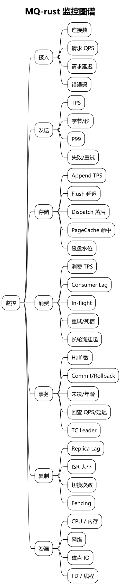
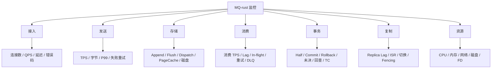

# 12 · 可观测性与监控图谱

> 原则：**每个关键路径必须有指标；每个异常必须有审计；每个 SLO 必须有告警。**  
> 技术栈：`tracing` + `metrics` + Prometheus + Grafana + OpenTelemetry（P1）+ 自研审计日志。

---

## 1. 监控图谱





---

## 2. 指标命名规范

```text
mq_<subsystem>_<metric>_<unit>
例：
mq_broker_send_tps
mq_store_commitlog_append_latency_seconds
mq_tx_pending_messages
mq_replication_lag_bytes
```

- Counter：`_total` 后缀。
- Gauge：当前值。
- Histogram：`_seconds` / `_bytes`。
- 标签：`cluster`、`broker`、`topic`、`group`、`queue`、`code`。
- 禁止高基数标签（msgId、txId、clientId）。

---

## 3. 核心指标

### 3.1 接入层

| 指标 | 类型 | 说明 |
|---|---|---|
| `mq_access_connections` | Gauge | 当前连接数（按协议） |
| `mq_access_requests_total` | Counter | 请求数（code/language） |
| `mq_access_request_duration_seconds` | Histogram | 请求延迟 |
| `mq_access_errors_total` | Counter | 错误码分布 |
| `mq_access_inflight_requests` | Gauge | 在途请求 |
| `mq_access_throttled_total` | Counter | 限流次数 |

### 3.2 发送

| 指标 | 类型 | 说明 |
|---|---|---|
| `mq_broker_send_tps` | Gauge | 发送 TPS |
| `mq_broker_send_bytes_total` | Counter | 发送字节 |
| `mq_broker_send_latency_seconds` | Histogram | 发送延迟 |
| `mq_broker_send_failed_total` | Counter | 失败（code） |
| `mq_broker_send_retry_total` | Counter | 客户端重试 |
| `mq_broker_message_size_bytes` | Histogram | 消息大小分布 |

### 3.3 存储

| 指标 | 类型 | 说明 |
|---|---|---|
| `mq_store_commitlog_append_tps` | Gauge | 追加 TPS |
| `mq_store_commitlog_append_latency_seconds` | Histogram | 追加延迟 |
| `mq_store_commitlog_flush_latency_seconds` | Histogram | 刷盘延迟 |
| `mq_store_commitlog_flush_total` | Counter | 刷盘次数 |
| `mq_store_commitlog_size_bytes` | Gauge | 文件大小/总量 |
| `mq_store_dispatch_lag_bytes` | Gauge | Dispatch 落后 |
| `mq_store_consumequeue_entries` | Gauge | CQ 条目数 |
| `mq_store_page_cache_hit_ratio` | Gauge | PageCache 命中率 |
| `mq_store_disk_used_ratio` | Gauge | 磁盘使用率 |
| `mq_store_disk_read_bytes_total` | Counter | 读带宽 |
| `mq_store_disk_write_bytes_total` | Counter | 写带宽 |

### 3.4 消费

| 指标 | 类型 | 说明 |
|---|---|---|
| `mq_consumer_pull_tps` | Gauge | 拉取 TPS |
| `mq_consumer_lag_messages` | Gauge | 积压条数（group/topic/queue） |
| `mq_consumer_lag_seconds` | Gauge | 积压时间 |
| `mq_consumer_inflight_messages` | Gauge | 在途消息 |
| `mq_consumer_retry_total` | Counter | 重试次数 |
| `mq_consumer_dlq_total` | Counter | 死信数 |
| `mq_consumer_offset_commit_total` | Counter | 位点提交 |
| `mq_consumer_longpoll_suspended` | Gauge | 挂起的长轮询 |
| `mq_consumer_rebalance_total` | Counter | Rebalance 次数 |

### 3.5 事务

| 指标 | 类型 | 说明 |
|---|---|---|
| `mq_tx_half_total` | Counter | 半消息数 |
| `mq_tx_commit_total` | Counter | 提交数 |
| `mq_tx_rollback_total` | Counter | 回滚数 |
| `mq_tx_pending_messages` | Gauge | 未决数 |
| `mq_tx_pending_age_seconds` | Histogram | 未决年龄 |
| `mq_tx_check_total` | Counter | 回查次数 |
| `mq_tx_check_failed_total` | Counter | 回查失败 |
| `mq_tx_check_latency_seconds` | Histogram | 回查延迟 |
| `mq_tx_timeout_total` | Counter | 超时数 |
| `mq_tx_materialize_latency_seconds` | Histogram | 物化延迟 |
| `mq_tx_duplicate_commit_total` | Counter | 重复提交 |
| `mq_tc_leader` | Gauge | 是否有 leader |
| `mq_tc_raft_apply_lag` | Gauge | Raft apply 落后 |

### 3.6 复制 / Controller

| 指标 | 类型 | 说明 |
|---|---|---|
| `mq_replication_lag_bytes` | Gauge | 副本落后字节 |
| `mq_replication_lag_seconds` | Gauge | 副本落后时间 |
| `mq_replication_isr_size` | Gauge | ISR 大小 |
| `mq_replication_fenced_total` | Counter | 被 fencing 的写入 |
| `mq_controller_election_total` | Counter | 选主次数 |
| `mq_controller_leader` | Gauge | 是否有 leader |
| `mq_controller_epoch` | Gauge | 当前 epoch |

### 3.7 资源

| 指标 | 说明 |
|---|---|
| `process_cpu_seconds_total` | CPU |
| `process_resident_memory_bytes` | RSS |
| `process_open_fds` | FD |
| `node_disk_io_time_seconds_total` | 磁盘 IO |
| `node_network_transmit_bytes_total` | 网络 |

---

## 4. Dashboard 设计

### 4.1 集群总览

- 集群健康：Broker 在线数、NameServer 在线数、Controller/TC leader。
- 总发送/消费 TPS、总积压、错误率。
- 磁盘水位 TopN、副本落后 TopN。
- 事务未决/超时。

### 4.2 Broker 详情

- 发送/拉取 TPS、延迟分位。
- CommitLog append/flush、Dispatch lag。
- PageCache、磁盘 IO、CPU/RSS。
- 连接数、长轮询挂起。

### 4.3 Topic / Group

- Topic 写入/读取 TPS、队列分布、保留时间。
- Group 积压、消费 TPS、重试、DLQ、Rebalance。

### 4.4 事务

- Half/Commit/Rollback 趋势。
- 未决数量/年龄分布。
- 回查 QPS/延迟/失败率。
- TC Raft 状态、leader 切换。
- 按 Producer Group/Topic 分解。

### 4.5 复制

- Master/Slave offset 差。
- ISR 变化、切换事件。
- Fencing 次数。

---

## 5. 告警规则（建议）

| 告警 | 条件 | 级别 |
|---|---|---|
| Broker 下线 | `up == 0` 持续 1m | P0 |
| 磁盘将满 | `disk_used_ratio > 0.8` 持续 5m | P0 |
| CommitLog 刷盘超时 | `flush_latency_p99 > 1s` 持续 5m | P1 |
| Dispatch 落后 | `dispatch_lag_bytes > 1GB` 持续 5m | P1 |
| 消费积压 | `consumer_lag_messages > 阈值` 持续 10m | P1 |
| 事务未决 | `tx_pending > 阈值` 持续 5m | P1 |
| 事务年龄 | `tx_pending_age_p99 > 5m` | P1 |
| 回查失败率 | `check_failed / check > 1%` 持续 5m | P1 |
| 副本落后 | `replication_lag_bytes > 512MB` 持续 5m | P1 |
| 无 TC leader | `tc_leader == 0` 持续 30s | P0 |
| 无 Controller leader | `controller_leader == 0` 持续 30s | P0 |
| Fencing 激增 | `fenced_total` 5m 增量 > 0 | P1 |
| 长轮询泄漏 | `longpoll_suspended` 持续上升 | P2 |

---

## 6. Tracing

### 6.1 Span 设计

```text
send_message (client)
├── route_lookup
├── remoting_encode
├── broker_send
│   ├── validate
│   ├── commitlog_append
│   ├── flush_wait
│   └── replication_wait
└── response

transaction
├── half_prepare
├── local_transaction (业务 span)
├── end_transaction
├── materialize
└── check_back
```

- 采样：生产 1%-5%，事务 100%（可配）。
- 属性：`topic`、`group`、`queue`、`msg_id`、`tx_id`、`code`、`latency_ms`。
- 不在 span 中放消息体/敏感字段。

---

## 7. 日志与审计

### 7.1 结构化日志

```json
{
  "ts": "2026-11-24T16:00:00.123+08:00",
  "level": "INFO",
  "target": "mq_broker::send",
  "trace_id": "...",
  "msg_id": "...",
  "topic": "orders",
  "queue": 3,
  "latency_ms": 2.1,
  "code": 0
}
```

- 热路径避免 `format!`；用字段。
- 错误日志带 `error_code`、`retryable`、`tx_id`（事务）。
- 日志轮转/压缩/保留。

### 7.2 审计事件

| 事件 | 字段 |
|---|---|
| `tx.commit` | txId, producerGroup, topic, operator, ts |
| `tx.rollback` | txId, reason, operator, ts |
| `tx.timeout` | txId, age, policy, ts |
| `tx.manual_resolve` | txId, action, operator, reason, ts |
| `acl.denied` | principal, resource, action, ip, ts |
| `topic.delete` | topic, operator, ts |
| `offset.reset` | group, topic, offset, operator, ts |

审计日志 append-only，定期归档到 WORM/对象存储；不可由普通运维删除。

---

## 8. SLO 建议

| SLO | 目标 | 测量 |
|---|---|---|
| 发送可用性 | 99.95% | 成功请求/总请求 |
| 发送延迟 | P99 < 20ms（同机） | Histogram |
| 消费延迟 | P99 < 100ms（无积压） | Histogram |
| 事务提交可见 | P99 < 100ms | Histogram |
| 消息持久性 | 同步复制 RPO=0 | 故障演练 |
| 集群恢复 | RTO < 30s | 切换演练 |
| 监控覆盖 | 关键路径 100% | 清单审计 |

---

## 9. 实施顺序

1. R1：`/metrics` + 发送/存储基础指标 + JSON 日志。
2. R2：消费/位点/重试/DLQ + Dashboard v1 + 告警。
3. R3：事务指标 + 事务 Dashboard + 审计。
4. R4：复制/Controller/TC Raft + Trace。
5. R5：SLO、容量、诊断包、审计归档。
