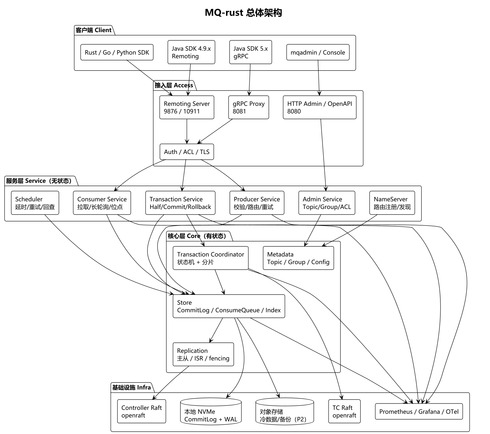
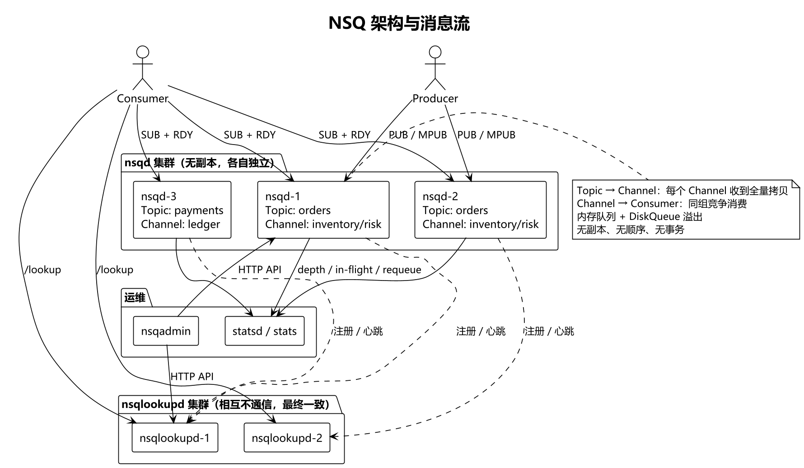
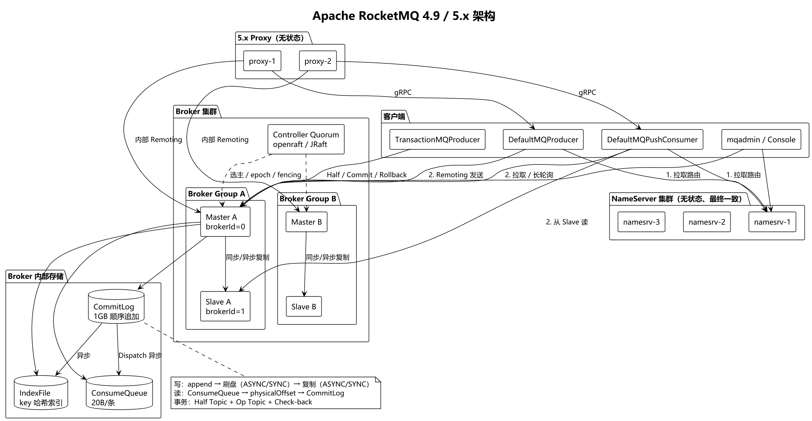
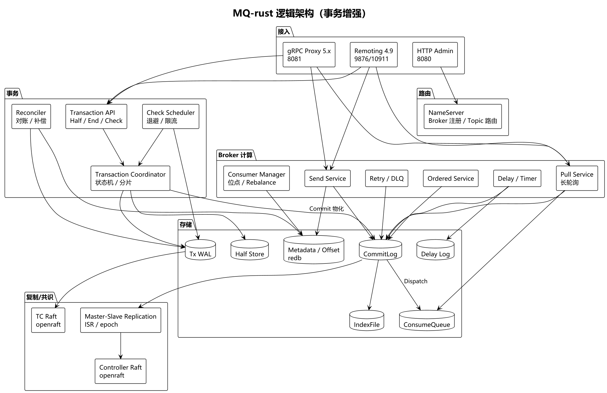
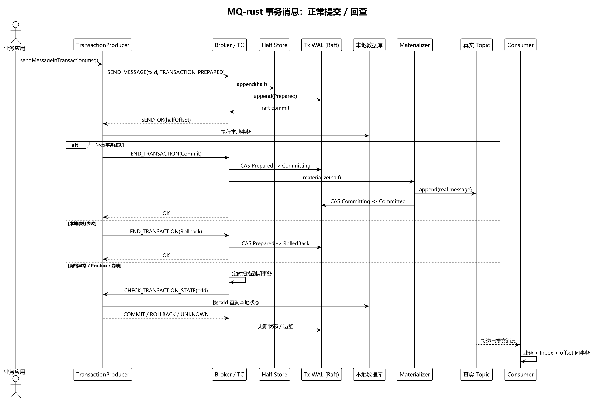
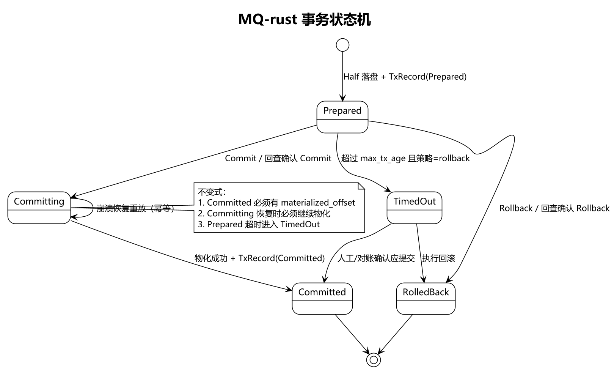
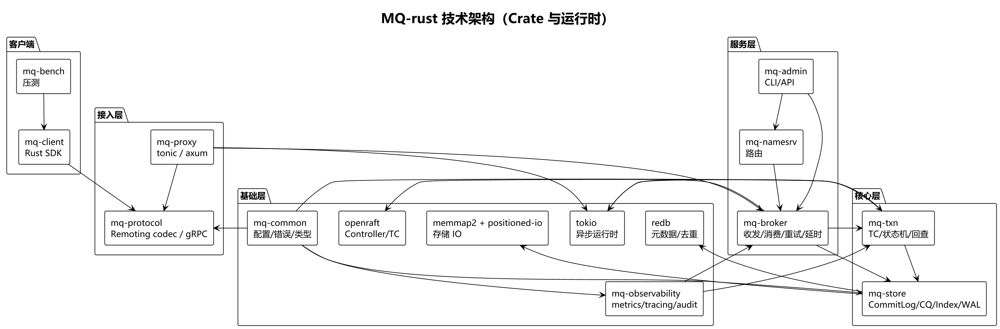
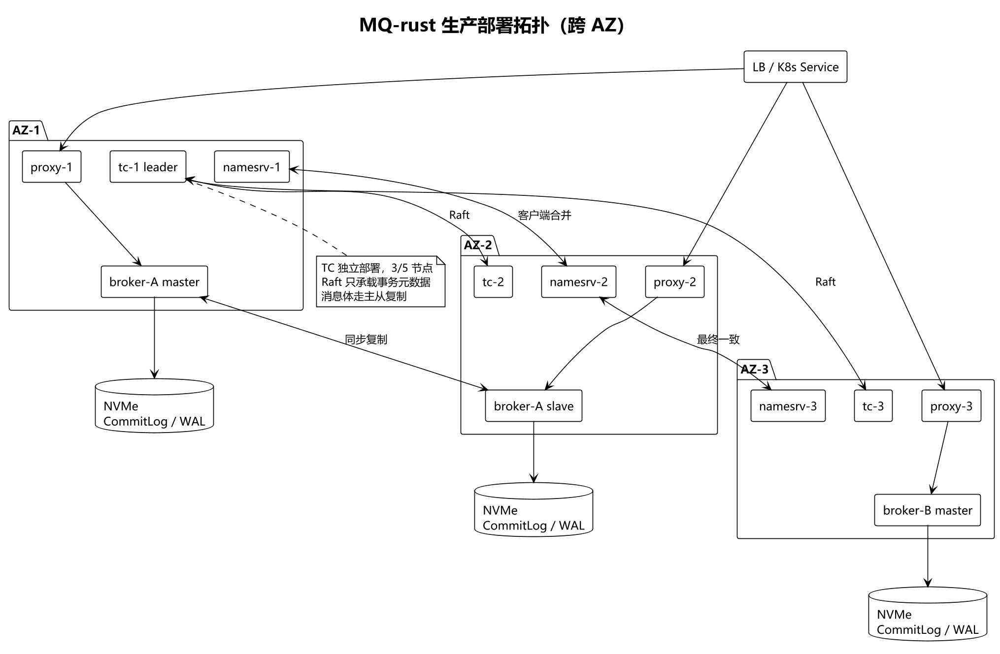
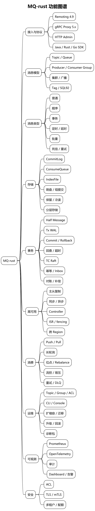
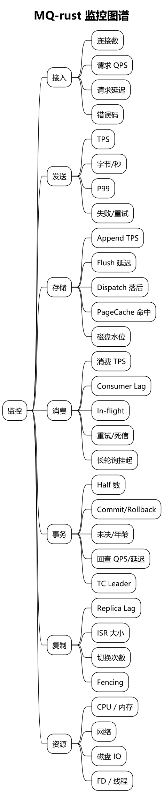

# 图表索引

> 源文件：`diagrams/*.puml`；渲染：`docs/images/*.png`（PlantUML 1.2024.8，Microsoft YaHei）。
> 重新渲染：
> ```powershell
> java -Dfile.encoding=UTF-8 -jar G:\MQ_soft\plantuml.jar -tpng -charset UTF-8 `
>   -o D:\AI-code-agent\mq-rust\docs\images D:\AI-code-agent\mq-rust\diagrams\*.puml
> ```

| 图 | 预览 | 说明 | 关联文档 |
|---|---|---|---|
| 总体架构 |  | 客户端、接入、服务、核心、基础设施五层；事务/复制/可观测 | `00`、`06` |
| NSQ 架构 |  | nsqd/nsqlookupd/nsqadmin；topic→channel；无副本 | `01` |
| RocketMQ 架构 |  | NameServer/Broker/Proxy/Controller；CommitLog/CQ/Index | `02` |
| MQ-rust 逻辑架构 |  | 事务增强后的逻辑组件与数据流 | `05`、`06` |
| 事务时序 |  | Half → 本地事务 → Commit/Rollback → 回查 | `05` |
| 事务状态机 |  | Prepared/Committing/Committed/RolledBack/TimedOut | `05` |
| 技术架构 |  | Crate 分层与依赖 | `06`、`07` |
| 部署拓扑 |  | 跨 AZ 的 NameServer/Broker/TC/Proxy | `06` |
| 功能图谱 |  | 11 大域的功能树 | `03` |
| 监控图谱 |  | 接入/发送/存储/消费/事务/复制/资源 | `12` |

## 关键图解读

### 总体架构

- **接入层**只做协议、鉴权、限流；4.9 走 Remoting，5.x 走 gRPC Proxy。
- **服务层**无状态，可水平扩展；NameServer 负责路由，Broker 负责收发/消费/事务入口。
- **核心层**有状态：Store 是唯一写入口；TC 管理事务状态；Replication 负责副本。
- **基础设施**：本地 NVMe 存 CommitLog/WAL；Controller/TC 用 openraft；Prometheus/Grafana/OTel。

### 事务时序

1. Producer 先发 Half（不可见），Broker 写 Half + Tx WAL。
2. Producer 执行本地事务，再发 Commit/Rollback。
3. Commit 时 TC 先 CAS 到 `Committing`，物化到真实 Topic，再 CAS 到 `Committed`。
4. 网络异常/崩溃时，TC 定时回查 Producer Group，按 DB 状态决定 commit/rollback。
5. 消费端用 Inbox + offset 同事务，保证重复消费不重复副作用。

### 功能图谱

11 个域：接入与协议、消息模型、消息类型、存储、事务、高可用、消费、运维、可观测、安全、生态。详细优先级与验收见 `03-功能图谱.md`。
